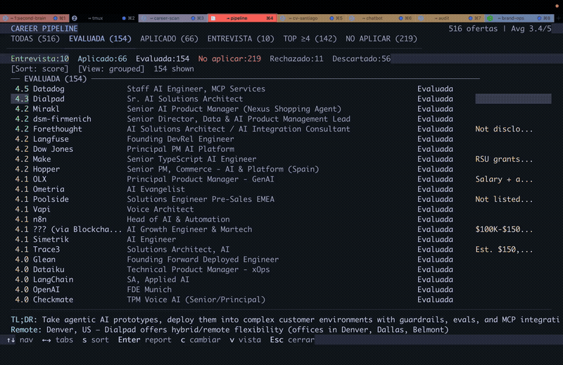
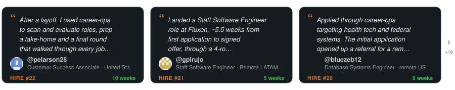
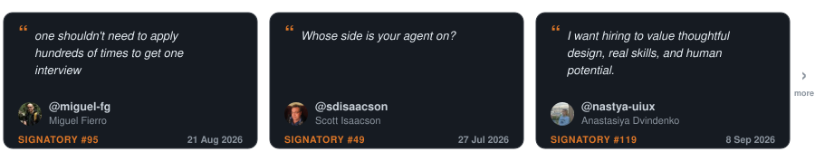
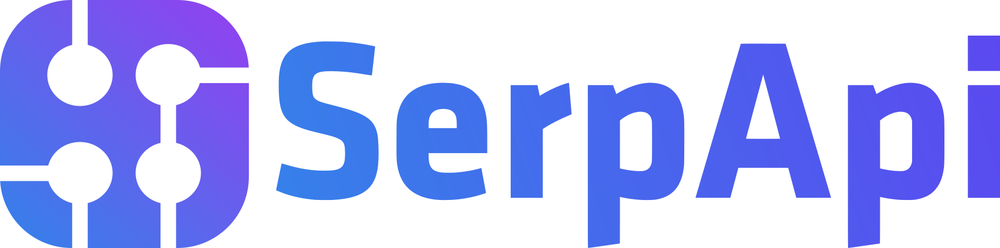
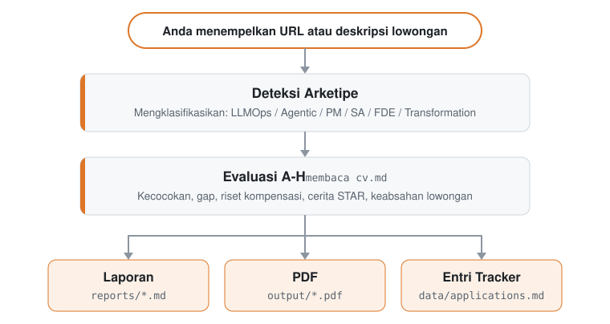

<p align="center"><picture><source media="(prefers-color-scheme: dark)" srcset="docs/wordmark-dark.svg"></picture></p>

<p align="center">Agen AI open-source untuk pencarian kerja.</p>

<p align="center">
  <a href="README.md">English</a> |
  <a href="README.es.md">Español</a> |
  <a href="README.de.md">Deutsch</a> |
  <a href="README.fr.md">Français</a> |
  <a href="README.pt-BR.md">Português (Brasil)</a> |
  <a href="README.ko-KR.md">한국어</a> |
  <a href="README.ja.md">日本語</a> |
  <a href="README.cn.md">简体中文</a> |
  <a href="README.zh-TW.md">繁體中文</a> |
  <a href="README.ua.md">Українська</a> |
  <a href="README.ru.md">Русский</a> |
  <a href="README.pl.md">Polski</a> |
  <a href="README.da.md">Dansk</a> |
  <a href="README.ta.md">தமிழ்</a> |
  <a href="README.ar.md">العربية</a> |
  <a href="README.hi.md">हिन्दी</a> |
  <a href="README.tr.md">Türkçe</a> |
  <a href="README.vi.md">Tiếng Việt</a> |
  <a href="README.id.md">Bahasa Indonesia</a>
</p>

<!-- The non-breaking spaces (&nbsp;) and word joiners (&#8288;) below decide where each line wraps on a phone. Keep them when editing. -->

<p align="center"><a href="https://github.com/santifer"></a>&nbsp;&nbsp;Dibuat oleh <a href="https://github.com/santifer"><strong>@santifer</strong></a>, bersama&nbsp;&nbsp;<a href="https://github.com/career-ops-hq/career-ops/blob/main/README.id.md#builders"><picture><source media="(prefers-color-scheme: dark)" srcset="docs/builders-stack-dark.svg"></picture></a>&nbsp;&nbsp;<a href="https://github.com/career-ops-hq/career-ops/blob/main/README.id.md#builders">700+ kontributor</a></p>

<p align="center">
<strong>Berbulan-bulan kirim CV tanpa&nbsp;kabar.</strong><br>
Jadi saya membangun filter yang saya&nbsp;butuhkan.
</p>

<p align="center">
<strong>740&nbsp;lowongan&nbsp;dievaluasi. 68&nbsp;dilamar. 12&nbsp;wawancara.&nbsp;1&nbsp;<em>offer</em>.</strong><br>
Saya pengguna pertamanya. Saya dapat pekerjaannya. Lalu&nbsp;saya&nbsp;jadikan&nbsp;open-&#8288;source.
</p>

<p align="center">
Tempel info lowongan. Di komputer Anda, alat ini mengecek apakah lowongan masih&nbsp;buka dan cocok untuk&nbsp;Anda.<br>
CV disesuaikan dan draf jawaban disiapkan. <strong>Anda&nbsp;yang&nbsp;menekan&nbsp;Submit.</strong>
</p>

<p align="center">
  
</p>

<p align="center"><sub>Pencarian kerja saya sendiri di tengah jalan, dengan&nbsp;UI&nbsp;berbahasa&nbsp;Spanyol.</sub></p>

<p align="center">
  Perusahaan pakai AI untuk menyaring kandidat.<br>
  <strong>Saya membekali kandidat dengan AI&nbsp;untuk&nbsp;<em>memilih</em>&nbsp;perusahaan.</strong>
</p>

<p align="center">
  Enam bulan kemudian, <strong>saya meninggalkan pekerjaan itu.</strong><br>
  Sekarang kami membangun career-ops, supaya&nbsp;Anda&nbsp;bisa&nbsp;mendapatkan&nbsp;pekerjaan&nbsp;impian&nbsp;Anda.
</p>

<p align="center"><a href="#giliran-anda">Coba pada satu lowongan&nbsp;↓</a> · <a href="https://santifer.io/career-ops-system">Baca cerita&nbsp;lengkapnya&nbsp;→</a></p>

<br>

<p align="center"><a href="HIRED.md"></a></p>

<p align="center">Orang-orang setelah saya menuliskan bagaimana mereka berhasil diterima kerja.</p>

<p align="center">
  <a href="HIRED.md"></a>
</p>

<p align="center"><sub>Setiap kartu adalah <em>issue</em> publik yang bisa Anda buka. Sudah dapat kerja? <a href="https://github.com/career-ops-hq/career-ops/issues/new?template=i-got-hired.yml">Tinggalkan kartu Anda →</a></sub></p>

<p align="center">⭐ <strong>Jika career-ops membantu Anda, satu bintang (<em>star</em>) akan membantu orang berikutnya menemukan&nbsp;alat&nbsp;ini.</strong></p>

<br>

<p align="center">
  <a href="https://wired.com.gr/article/to-ai-ergaleio-pou-fernei-epanastasi-ston-tropo-pou-psachnoume-douleia/" rel="noopener noreferrer nofollow"><picture><source media="(prefers-color-scheme: dark)" srcset="docs/press/wired-dark.svg"></picture></a>
  &nbsp;&nbsp;&nbsp;&nbsp;
  <a href="https://www.businessinsider.com/how-i-built-tool-filter-job-listings-landed-head-ai-2026-4" rel="noopener noreferrer nofollow"><picture><source media="(prefers-color-scheme: dark)" srcset="docs/press/business-insider-dark.svg"></picture></a>
</p>

<p align="center">
  <a href="https://vercel.com/open-source-program"></a>
</p>

<p align="center">
  <a href="https://trendshift.io/repositories/25195" rel="noopener noreferrer"></a>
  &nbsp;&nbsp;&nbsp;&nbsp;
  <a href="https://www.producthunt.com/products/santifer-io?utm_source=badge-featured&utm_medium=badge" rel="noopener noreferrer"></a>
</p>

## Giliran Anda

Tempel satu lowongan yang tadinya hendak Anda lamar malam ini. Kalau hasilnya menyarankan <em>jangan lamar</em>, waktu malam Anda terselamatkan. Kalau hasilnya berupa rencana, Anda tahu persis apa langkah selanjutnya.

```bash
npx @santifer/career-ops init
```

<p align="center"><sub>Open source. Lokal. Berjalan di AI CLI yang sudah Anda gunakan. <a href="docs/RUNNING_ON_A_BUDGET.md">Termasuk dukungan model gratis dan lokal.</a></sub></p>


## Anda tidak harus mencari kerja sendirian

Heningnya kabar setelah Anda menekan tombol kirim bukanlah salah Anda. Cukup banyak orang yang mengalami hal serupa hingga akhirnya merumuskan prinsip ini dalam enam baris:

> Melamar lebih matang ke lebih sedikit tempat. Kualitas sinyal di atas kuantitas. Bukti nyata di atas sekadar kata kunci. Manusia yang mengambil keputusan. Lokal-pertama (*local-first*). Martabat di kedua sisi meja.

<p align="center"><a href="https://career-ops.org/manifesto?utm_source=readme"></a></p>

<p align="center">Beberapa dari mereka, melalui kata-kata mereka sendiri.</p>

<p align="center">
  <a href="https://career-ops.org/manifesto?utm_source=readme"></a>
</p>

<p align="center"><sub>Setiap tanda tangan adalah <em>commit</em> yang bisa Anda audit. <a href="https://career-ops.org/manifesto?utm_source=readme">Baca semuanya, atau tambahkan tanda tangan Anda →</a></sub></p>

<br>

Proses rekrutmen tidak akan membaik dengan sendirinya. Orang-orang yang menjalaninyalah yang bisa memperbaikinya—dan mereka sudah berkumpul di sini, saling mencocokkan catatan dan membantu mengatur konfigurasi satu sama lain.

<a id="builders"></a>

<p align="center"><a href="CONTRIBUTING.md"></a></p>

[Di sinilah perbaikan itu ditulis](CONTRIBUTING.md). Sebuah ruang bersama, bukan klub eksklusif. **Mari kita bangun bersama.**

<p align="center"><a href="https://discord.gg/8pRpHETxa4"></a></p>

## Sponsor

career-ops gratis untuk para pencari kerja, selamanya. Perusahaan-perusahaan berikut mensponsori proyek ini:

<p align="center">
  <a href="https://serpapi.com/career-ops-org" title="SerpApi"></a>
</p>

<p align="center"><strong>SerpApi</strong> · Build a portfolio project with live search data. SerpApi gives developers structured JSON/Markdown from Google Search, Maps, Shopping, and other engines through a simple API call.</p>

> Sponsor hanya membeli visibilitas yang diberi label secara jelas, bukan pengaruh: tidak ada sejumlah uang pun yang dapat mengubah *roadmap* atau menyisipkan apa pun ke dalam produk. Sponsor tidak pernah muncul dalam evaluasi, peringkat, maupun rekomendasi.

## Apa yang dilakukan career-ops untuk Anda

Tempel info lowongan. Alat ini memberi tahu apakah lowongan itu layak diperjuangkan malam ini.

- **Masih buka?** Mengecek apakah lowongan tersebut masih aktif sebelum Anda mulai menulis sepatah kata pun.
- **Kurang cocok?** Memberi skor kecocokan posisi terhadap CV asli Anda dan menyarankan untuk melewati lowongan yang kurang pas. Anda tetap bisa mengabaikan saran ini.
- **Layak dicoba?** Menyiapkan draf CV, *cover letter*, dan jawaban formulir lamaran. Anda yang membaca, Anda yang mengirim.
- **Siapa yang harus dihubungi?** Mencari orang yang tepat dan membuatkan draf pesannya. Alat ini tidak pernah mengirim pesan tersebut.
- **Ke mana larinya semua data?** Setiap lamaran tetap tersimpan di komputer Anda. Tidak ada satu pun yang diunggah ke tempat kami.
- **Apa yang perlu saya pelajari?** Setelah serangkaian penolakan, alat ini menunjukkan letak kekurangan (*skill gap*) Anda.

Percobaan awal mungkin terasa belum mulus karena sistem ini belum mengenal Anda. Ajak bicara: berikan CV Anda, beri tahu apa yang Anda incar dan apa yang Anda tolak. Anggap saja seperti minggu pertama seorang rekruter pribadi Anda.

Saat pertama kali dijalankan, semua itu akan ditanyakan langsung lewat obrolan (*chat*). Tidak ada yang perlu dikonfigurasi secara manual.

## Apa yang tidak akan dilakukan career-ops

- **Mengirim lamaran secara otomatis (*auto-submit*).** Alat ini membuatkan draf jawaban untuk setiap kolom; Anda yang meninjau dan menekan tombol Submit. Skripnya tidak pernah melakukan request POST (`prepare-application.mjs`).
- **Mengirim email.** Hanya sebatas draf. Tidak ada mekanisme pengiriman email sama sekali di dalam *codebase* ini.
- **Mengirim data diam-diam (*phone home*).** Tanpa telemetri, tanpa *backend* dari pihak kami. CV Anda hanya dikirim dari komputer Anda langsung ke penyedia AI yang Anda pilih, tidak ke tempat lain. Satu-satunya catatan publik adalah repositori ini: `HIRED.md` beserta *issue*-nya.
- **Mendorong Anda melamar di bawah skor 4.0/5.** Sistem akan menyarankan Anda untuk tidak melamar. Anda tetap bisa memilih untuk melanjutkannya, dan sistem akan mencatatnya demikian.

Alat ini menyusun ulang kalimat di CV Anda, tetapi pantang mengarang bebas. Pengecekan di dalam kode akan menghentikan pembuatan PDF apabila ada angka atau fakta yang tidak ditemukan baik di dalam CV maupun di ringkasan artikel (*article digest*) Anda. Meski begitu, sistem belum bisa menilai setiap perubahan gaya bahasa secara sempurna. Selalu baca kembali setiap CV sebelum Anda mengirimkannya. Detail selengkapnya ada di [FAQ](#faq).

## Fitur

| Fitur | Deskripsi |
| ------------------------ | ---------------------------------------------------------------------------------------------------------------------------------------- |
| **Evaluasi A-H** | Ringkasan peran, kecocokan CV (lengkap dengan seberapa penting tiap persyaratan untuk lowongan tersebut, serta label per persyaratan apakah bobot itu berasal dari kata-kata langsung di JD, strukturnya, atau sekadar estimasi; estimasi tidak pernah bisa masuk kategori teratas), strategi level, riset kompensasi, personalisasi, persiapan wawancara (STAR+R) -- ditambah pengecekan keabsahan lowongan pada Blok G (apakah masih buka, apakah hasil *repost*: berupa observasi, bukan vonis), dan sinyal izin kerja (*Work-Auth*) yang menandai pernyataan eksplisit dalam JD bahwa sponsor visa tidak tersedia sebagai penghalang mutlak (*hard blocker*) |
| **Human-in-the-Loop** | AI mengevaluasi dan memberi rekomendasi, Anda yang memutuskan dan bertindak. Sistem ini tidak pernah mengirim lamaran -- keputusan akhir selalu ada di tangan Anda <!-- hitl: absolute guarantee. Do not add "automatically", "by itself", "without your permission" or any other hedge when translating this row. --> |
| **Pembuatan PDF Ramah ATS** | CV yang mudah dibaca mesin ATS dan disesuaikan dengan setiap JD berdasarkan pengalaman asli Anda, menggunakan desain font Space Grotesk + DM Sans |
| **Generator Cover Letter** | *Cover letter* berbasis riset dengan pencocokan kata kunci (*keyword mirroring*), empat pilihan sudut pandang interaktif (alasan/masalah/pendekatan/nada bicara), tahap persetujuan draf di ruang *chat*, dan ekspor PDF ukuran A4 lewat *pipeline* HTML + Playwright yang sama dengan CV. Otomatis membuat draf di setiap evaluasi; lengkapi dan cetak kapan saja lewat `/career-ops cover` |
| **Lebih dari Sekadar CV** | Riset perusahaan ([`deep`](modes/deep.md)) menggali strategi AI, langkah bisnis terbaru, budaya *engineering*, dan sudut pandang yang sebaiknya ditonjolkan dari profil Anda. Pencarian kontak ([`contacto`](modes/contacto.md)) mengidentifikasi *hiring manager*, rekruter, atau rekan setim yang tepat untuk dihubungi sekaligus menyiapkan draf pesan LinkedIn ≤300 karakter yang disesuaikan dengan tipe kontaknya. Draf email lamaran formal ([`email`](modes/email.md)) mengubah laporan evaluasi atau teks JD menjadi baris subjek, isi email, dan daftar periksa lampiran tanpa mengirim, mengajukan, atau mengeklik apa pun. Lamaran memasukkan Anda ke dalam antrean; riset membuka peluang percakapan. |
| **Analisis Pola** | Pola penolakan dan rasio lolos per kanal ATS (`analyze-patterns.mjs`), statistik *funnel* keseluruhan (`stats.mjs`), serta deteksi *repost* yang bisa menjadi indikasi lowongan hantu / *ghost job* (`detect-reposts.mjs`) |

<details>
<summary><b>Semua kemampuan lainnya</b></summary>

| Fitur | Deskripsi |
| ------------------------ | ---------------------------------------------------------------------------------------------------------------------------------------- |
| **Auto-Pipeline** | Tempel URL, dapatkan evaluasi lengkap + PDF + entri di *tracker* |
| **Bank Cerita Wawancara** | Mengumpulkan cerita berformat STAR+Reflection dari berbagai evaluasi -- 5-10 cerita utama yang bisa Anda adaptasikan untuk menjawab pertanyaan *behavioral* |
| **Skrip Negosiasi** | Kerangka kerja negosiasi gaji, cara menanggapi potongan gaji berbasis lokasi geografis, serta pemanfaatan tawaran kerja lain (*competing offer*) |
| **Draf Email Lamaran** | Draf email lamaran formal untuk jalur rekruter, *referral*, maupun *cold email* dari laporan atau teks JD, lengkap dengan subjek, daftar periksa lampiran, poin kecocokan berbasis sumber asli, dan blok kontak dari profil Anda. Hanya berupa draf -- career-ops tidak pernah mengirim, mengajukan, atau mengeklik apa pun. |
| **Pemindai Portal** | Lebih dari 100 perusahaan sudah dikonfigurasi dari awal (Anthropic, OpenAI, ElevenLabs, Retool, n8n...) + kueri pencarian web kustom lintas Ashby, Greenhouse, Lever, Wellfound |
| **Penemuan Perusahaan yang Baru Mendapat Pendanaan** | Perintah `company:funded` yang mengutamakan peninjauan (*review-first*) menampilkan daftar perusahaan yang baru mendapat pendanaan beserta diagnostik sumber dari *feed* publik terstruktur tanpa mengubah data Anda |
| **Pemrosesan Batch** | Evaluasi paralel menggunakan *worker* CLI *headless* (`claude -p` / `opencode run`) |
| **Dashboard TUI** | Antarmuka terminal (TUI) untuk menjelajahi, memfilter, dan mengurutkan *pipeline* lamaran Anda |
| **Integritas Pipeline** | Penggabungan (*merge*) otomatis, penghapusan duplikat, normalisasi status, dan pemeriksaan kesehatan data |
| **Rangkaian Wawancara** | Rencana persiapan berbasis blok waktu, sesi latihan interaktif lengkap dengan umpan balik, evaluasi pasca-wawancara ([`interview/`](modes/interview/README.md)), serta pendeteksi tanda bahaya (*red-flag*) perusahaan ([`interview-redflag`](modes/interview-redflag.md)) |
| **Tahap Offer** | Pendamping pembacaan kontrak kerja -- membedah pasal demi pasal beserta daftar pertanyaan untuk dikonsultasikan ke pengacara ([`offer-prep`](modes/offer-prep.md)) -- dan penganalisis selisih gaji antara ekspektasi, iklan lowongan, dan tawaran aktual (`salary-gap.mjs`) |
| **Follow-up & Balasan** | Kalkulator ritme *follow-up* dan pengingat terjadwal (`followup-cadence.mjs`, `followup-seed.mjs`); dapat dinonaktifkan dengan mengatur `follow_ups.enabled: false` di `config/profile.yml`; klasifikasi balasan perusahaan untuk memperbarui *tracker* ([`reply-watch`](modes/reply-watch.md)) |
| **Sistem Plugin** | Integrasi opsional (Gmail, Notion, Apify + registri komunitas), nonaktif secara bawaan -- lihat [docs/PLUGINS.md](docs/PLUGINS.md) |

</details>

## Mulai Cepat (Quick Start)

**Cara tercepat, cukup satu perintah:**

```bash
npx @santifer/career-ops init
```

> 💡 `npx` sudah sepaket dengan [Node.js](https://nodejs.org): perintah ini menjalankan *installer* satu kali tanpa perlu menginstal apa pun secara global. Belum punya Node? Instal terlebih dahulu.
> (Sudah menggunakan CLI seperti Claude Code / Gemini / Codex? Berarti Anda sudah memilikinya.)

Perintah di atas akan mengkloning rilis terbaru ke dalam folder `./career-ops` dan menginstal semua dependensi. Selanjutnya:

```bash
cd career-ops
claude   # atau codex / qwen / opencode / agy / grok — buka AI CLI Anda di direktori ini
```

**Saat pertama kali dijalankan, career-ops akan memandu proses penyiapan (CV, profil, dan target peran Anda) cukup lewat obrolan. Tidak ada file yang perlu diedit secara manual.**

<details>
<summary><b>Lebih suka menyiapkannya secara manual? (git clone)</b></summary>

```bash
git clone https://github.com/career-ops-hq/career-ops.git
cd career-ops && npm install
npx playwright install chromium   # hanya diperlukan untuk pembuatan PDF
# Pada distro Linux selain Debian/Ubuntu (Fedora, Arch, ...), library sistem
# untuk Chromium tidak terinstal lewat perintah di atas — instal sendiri menggunakan
# package manager distro Anda jika pembuatan PDF gagal membuka browser
# (dokumentasi resmi Playwright mencantumkan daftar library yang dibutuhkan untuk tiap platform).

# 2. Buka AI CLI Anda di direktori ini. Saat pertama kali dijalankan, CLI akan
#    memandu penyiapan (CV, profil, dan target peran Anda) lewat obrolan
claude   # atau codex / opencode / qwen / agy / grok

# Lalu minta CLI Anda untuk menyesuaikan sistem dengan kebutuhan Anda:
# "Change the archetypes to backend engineering roles"
# "Translate the modes to English"
# "Add these 5 companies to portals.yml"
# "Update my profile with this CV I'm pasting"

# 3. Mulai gunakan
# Tempel URL lowongan atau teks JD untuk memicu auto-pipeline
# Jika CLI Anda mendukung slash command, gunakan /career-ops (atau alias spesifik CLI tersebut)
# Di Codex, minta mode yang sama menggunakan bahasa sehari-hari, misalnya:
# "Run the career-ops scan mode"
# "Run the career-ops pipeline mode for data/pipeline.md"
# "Run the career-ops pdf mode for the latest evaluated role"
# "Run the career-ops tracker mode and summarize the current statuses"
```

</details>

### Memindai melalui *outbound proxy*

Fungsi `fetch()` bawaan Node mungkin mengabaikan variabel `HTTP_PROXY`, `HTTPS_PROXY`, dan `NO_PROXY` di dalam *sandbox* yang hanya mengizinkan koneksi lewat *proxy*. Request ke penyedia layanan dapat memanfaatkan variabel-variabel tersebut dengan menjalankan `CAREER_OPS_TRUST_PROXY_EGRESS=1 node scan.mjs`. Cara ini menggunakan *proxy dispatcher* yang hanya berlaku per request; request lain yang tidak berkaitan tidak akan terpengaruh, dan tujuan yang tercantum di `NO_PROXY` tetap diperiksa oleh mekanisme perlindungan alamat privat lokal.

Aktifkan *flag* ini **hanya jika *proxy* yang dikonfigurasi memang memblokir koneksi ke alamat privat, *loopback*, dan metadata**. Saat *proxy* melakukan resolusi alamat tujuan dari jarak jauh (*remote*), career-ops tidak dapat memverifikasi alamat akhir tersebut secara lokal; pihak *proxy*-lah yang harus menegakkan batas perlindungan SSRF tersebut. Tanpa pengaturan kepercayaan eksplisit ini, request ke penyedia layanan akan tetap menggunakan jalur transportasi langsung seperti biasa, dan jika terjadi kegagalan DNS, pesan error akan menyebutkan konfigurasi *proxy* yang diperlukan. URL *proxy* yang memuat kredensial wajib menggunakan HTTPS; *proxy* HTTP tanpa kredensial tetap didukung. Instalasi yang sudah ada akan tetap menggunakan jalur langsung setelah pembaruan sistem; variabel *environment* *proxy* saja tidak cukup untuk mengaktifkannya. Sebelum mengaktifkan *flag* ini, jalankan `npm install` di direktori career-ops untuk menginstal dependensi tambahan `undici`. Modul ini hanya dimuat ketika *flag* diaktifkan beserta *proxy* yang terkonfigurasi, sehingga pemindaian langsung tetap berfungsi normal meskipun dependensi tersebut belum terinstal.

### Instalasi global

```bash
npm i -g @santifer/career-ops
```

Perintah ini menginstal *binary* `career-ops` secara global sehingga Anda bisa menjalankan `career-ops init [folder]` tanpa `npx`. `init` adalah satu-satunya perintahnya: ia menyiapkan *workspace*, dan semua langkah sesudahnya berlangsung di dalam AI coding CLI Anda (lihat Penggunaan di bawah), bukan melalui *binary* ini.

**Mana yang sebaiknya Anda gunakan?**
- `npx @santifer/career-ops init`: paling pas untuk penggunaan pertama kali; membuatkan folder proyek khusus.
- `npm i -g @santifer/career-ops`: jika Anda lebih suka mengetik `career-ops init` daripada bentuk `npx`. Instalasi ini tidak menambahkan perintah lain.

> **Sistem ini dirancang agar bisa dikustomisasi langsung oleh AI coding CLI Anda.** Mode, arketipe peran, bobot penilaian, hingga skrip negosiasi -- cukup minta AI CLI Anda untuk mengubahnya. Karena ia membaca file yang sama dengan yang ia gunakan, ia tahu persis bagian mana yang harus diedit.

Lihat [docs/SETUP.md](docs/SETUP.md) untuk panduan instalasi lengkap, [docs/RUNNING_ON_A_BUDGET.md](docs/RUNNING_ON_A_BUDGET.md) untuk petunjuk menjalankan career-ops secara hemat memakai model kustom atau lokal (serta [docs/FREE_TIER.md](docs/FREE_TIER.md) untuk menjalankannya tanpa biaya di *free tier* Antigravity CLI), [docs/AUTOMATION.md](docs/AUTOMATION.md) untuk menjadwalkan pemindaian berkala dan resep penyaringan nol-token menjadi daftar incaran (*shortlist*), [docs/KEEPING_PORTALS_LIVE.md](docs/KEEPING_PORTALS_LIVE.md) untuk menjaga daftar perusahaan Anda tetap mutakhir, [docs/APPLY_AUTOFILL.md](docs/APPLY_AUTOFILL.md) untuk detail alur pengisian formulir ATS otomatis, [docs/LINKEDIN_JOIN.md](docs/LINKEDIN_JOIN.md) untuk mencocokkan ekspor koneksi LinkedIn dengan daftar perusahaan di *funnel* Anda, serta [docs/FAQ.md](docs/FAQ.md) untuk jawaban atas pertanyaan umum seputar instalasi, termasuk [bagaimana pelacakan sumber cerita (*story provenance*) mencegah munculnya angka karangan](docs/FAQ.md#why-does-career-ops-refuse-to-use-a-number-from-my-story-bank). Prinsip desain dijelaskan di [ARCHITECTURE.md](ARCHITECTURE.md); alur kerja *runtime* dapat dilihat di [docs/ARCHITECTURE.md](docs/ARCHITECTURE.md).

## Penggunaan

career-ops menggunakan *router* perintah bersama. Pada CLI yang mendukung *slash command*, tampilannya seperti ini:

```
/career-ops            → Menampilkan semua perintah yang tersedia
/career-ops {JD}       → AUTO-PIPELINE: evaluasi + laporan + PDF + tracker (tempel teks atau URL)
/career-ops pipeline   → Memproses URL yang tertunda di kotak masuk (data/pipeline.md)
/career-ops oferta     → Hanya evaluasi, blok A sampai H (tanpa buat PDF otomatis)
/career-ops ofertas    → Membandingkan dan mengurutkan beberapa lowongan/tawaran
/career-ops contacto   → Langkah strategis LinkedIn: cari kontak + buat draf pesan
/career-ops deep       → Prompt riset mendalam tentang perusahaan
/career-ops interview-prep → Membuat dokumen persiapan wawancara khusus untuk perusahaan terkait
/career-ops interview    → Wawancara interaktif untuk onboarding profil/CV awal
/career-ops master-profile → Mengimpor, meninjau, dan memvalidasi Master Career Profile Anda
/career-ops eu-swe     → Kalibrasi lamaran SWE pasar Eropa sebelum tahap CV/lamar/wawancara
/career-ops interview/plan → Rencana persiapan berbasis blok waktu untuk wawancara mendatang
/career-ops interview/practice → Latihan wawancara, satu pertanyaan tiap giliran beserta umpan balik
/career-ops interview/debrief → Evaluasi pasca-wawancara: tutup celah kekurangan, prediksi ronde berikutnya
/career-ops interview-redflag → Menganalisis tanda peringatan (red flag) perusahaan sebelum bergabung
/career-ops pdf        → Hanya buat PDF, CV yang dioptimalkan untuk ATS
/career-ops text       → CV Markdown yang disesuaikan (mengikuti format cv.md, tanpa PDF)
/career-ops latex      → Mengekspor CV sebagai file .tex LaTeX/Overleaf
/career-ops latex-tex  → Menyesuaikan file resume.tex milik Anda secara langsung (opsional; cv.md tetap menjadi bawaan)
/career-ops cover      → Cover letter: tempel JD mandiri atau jalankan /career-ops cover {slug}
/career-ops email      → Draf email lamaran formal (hanya draf; tidak pernah mengirim, submit, atau mengeklik)
/career-ops add        → Menambahkan proyek/makalah/peran ke CV Anda (ambil data + pratinjau + konfirmasi)
/career-ops expand     → Menemukan dan menambahkan kompetensi yang belum tercatat dari tautan profil secara otomatis
/career-ops training   → Mengevaluasi kursus/sertifikasi terhadap tujuan utama (North Star) Anda
/career-ops project    → Mengevaluasi ide proyek portofolio
/career-ops tracker    → Ringkasan status seluruh lamaran
/career-ops agent-inbox → Mengantrekan/memproses permintaan untuk sesi berikutnya (data/agent-inbox.md)
/career-ops apply      → Asisten pengisian lamaran langsung (membaca formulir + menyiapkan jawaban)
/career-ops scan       → Memindai portal kerja dan menemukan lowongan baru
/career-ops discover   → Memetakan daftar perusahaan ke papan ATS yang bisa dipindai + menambahkannya ke portals.yml (nol-token)
/career-ops batch      → Pemrosesan batch dengan worker paralel
/career-ops patterns   → Menganalisis pola penolakan dan mempertajam target lamaran
/career-ops offer-prep → Membaca surat tawaran/kontrak kerja bersama kandidat: bedah pasal + daftar pertanyaan untuk pengacara (bukan nasihat hukum)
/career-ops titles     → Menyarankan nama posisi/jabatan serupa dari CV Anda untuk memperluas pencarian
/career-ops upskill    → Analisis gabungan kesenjangan keahlian (skill-gap) dari laporan evaluasi Anda
/career-ops followup   → Pelacak ritme follow-up: menandai yang lewat tenggat dan menyiapkan drafnya
/career-ops reply-watch → Mengklasifikasikan balasan perusahaan dan menyarankan pembaruan status di tracker
/career-ops outcome    → Mencatat hasil akhir lamaran & mengarsipkan dokumen terkait
/career-ops calibrate  → Laporan tinjauan: apakah skor evaluasi Anda akurat memprediksi hasil di dunia nyata? Membaca data /outcome; tidak pernah mengubah rumus penilaian
/career-ops update     → Memperbarui file sistem career-ops dengan pratinjau diff + pemeriksaan kompatibilitas
```

Atau cukup tempelkan URL maupun deskripsi lowongan kerja secara langsung -- career-ops akan mendeteksinya secara otomatis dan menjalankan seluruh rangkaian *pipeline*.

Di Codex, ketersediaan *slash command* tidak selalu dijamin. Gunakan nama mode yang sama di dalam *prompt* biasa, atau panggil melalui `codex exec`.

## Cara Kerjanya

<p align="center"><picture><source media="(prefers-color-scheme: dark)" srcset="docs/how-it-works-id-dark.svg"></picture></p>

## Integrasi Antigravity CLI

career-ops mendukung Antigravity CLI secara bawaan (*native*), sama seperti dukungannya terhadap Claude Code dan OpenCode. Semua *slash command* tersedia melalui satu pintu masuk *skill* bersama dengan menggunakan logika evaluasi `modes/*.md` yang sama.

Google telah mengalihkan akses Gemini CLI konsumen ke Antigravity CLI. File `GEMINI.md` kini berfungsi sebagai pelindung kompatibilitas (*no-op guard*) agar Antigravity tidak menduplikasi instruksi proyek secara ganda saat membaca `AGENTS.md` dan `GEMINI.md` sekaligus.

### Antigravity CLI Native

```bash
# 1. Jalankan di dalam direktori career-ops
cd career-ops
agy

# 2. Gunakan perintah terpadu /career-ops beserta sub-perintahnya:
/career-ops "Senior AI Engineer at Anthropic..."
/career-ops pipeline
/career-ops scan
/career-ops pdf
/career-ops tracker
```

*Skill* ini didefinisikan menggunakan standar terbuka di `.agents/skills/career-ops/SKILL.md` dan dihubungkan (*symlink*/referensi) ke masing-masing CLI yang didukung (misalnya `.claude/`, `.qwen/`, `.antigravitycli/`, `.grok/`). Cursor secara otomatis mengenali *skill* bersama yang ada di dalam `.agents/skills/`.

## Integrasi Codex

career-ops mendukung Codex melalui *router* bersama yang sama, namun cara pemanggilannya sedikit berbeda dari CLI yang mendaftarkan *slash command* secara otomatis. Untuk panduan lengkapnya, lihat [docs/CODEX.md](docs/CODEX.md).

### Codex Interaktif

```bash
cd career-ops
codex
```

*Slash command* tidak selalu tersedia di Codex. Jika `/career-ops` tidak muncul, minta Codex menjalankan modenya secara langsung menggunakan kalimat biasa:

```text
Evaluate this JD with career-ops auto-pipeline: https://company.com/jobs/123
Run the career-ops scan mode and summarize new matches.
Run the career-ops pipeline mode for data/pipeline.md.
Run the career-ops pdf mode for the latest evaluated role.
Run the career-ops tracker mode and summarize the current statuses.
```

### Codex Sekali Jalan (`codex exec`)

```bash
codex exec "Evaluate this JD with career-ops auto-pipeline: https://company.com/jobs/123"
codex exec "Run career-ops scan mode in this repo and summarize new matches."
codex exec "Run career-ops pipeline mode for data/pipeline.md."
codex exec "Run career-ops pdf mode for the latest evaluated role."
codex exec "Run career-ops tracker mode and summarize the current statuses."
```

## Integrasi Grok Build CLI

career-ops mendukung Grok Build CLI secara *native*, sama seperti Claude Code dan OpenCode. `AGENTS.md` dimuat secara otomatis sebagai aturan proyek, dan semua *slash command* dapat diakses lewat pintu masuk *skill* bersama.

### Grok Build CLI Native

```bash
# 1. Jalankan di dalam direktori career-ops
cd career-ops
grok

# 2. Gunakan perintah terpadu /career-ops beserta sub-perintahnya:
/career-ops "Senior AI Engineer at Anthropic..."
/career-ops pipeline
/career-ops scan
/career-ops pdf
/career-ops tracker
```

Untuk menjalankan *batch worker* secara *headless*, gunakan `grok -p "prompt"` (tambahkan `--yolo` untuk menyetujui eksekusi alat secara otomatis).

## Integrasi Pi

career-ops mendukung [Pi](https://github.com/earendil-works/pi) secara *native* tanpa memerlukan file pembungkus (*wrapper*) tambahan: Pi langsung membaca `AGENTS.md` dari *root* repositori sebagai konteks proyek dan mengenali *skill* bersama di `.agents/skills/career-ops/SKILL.md` secara mandiri. *Router* perintah kemudian dapat dipanggil lewat `/skill:career-ops`.

### Pi Native

```bash
# 1. Jalankan di dalam direktori career-ops
cd career-ops
pi

# 2. Gunakan skill bersama beserta sub-perintahnya:
/skill:career-ops "Senior AI Engineer at Anthropic..."
/skill:career-ops pipeline
/skill:career-ops scan
/skill:career-ops pdf
/skill:career-ops tracker
```

### Pi Sekali Jalan (`pi -p`)

```bash
pi -p "Evaluate this JD with career-ops auto-pipeline: https://company.com/jobs/123"
pi -p "Run career-ops scan mode and summarize new matches."
pi -p "Run career-ops tracker mode and summarize the current statuses."
```

Jika versi Pi yang Anda gunakan membatasi sumber daya proyek dengan persetujuan kepercayaan (*trust decision*), jalankan `/trust` satu kali di dalam repositori lalu mulai ulang `pi` agar *skill* proyek dimuat (`/trust` berlaku untuk proses Pi berikutnya), atau jalankan dengan opsi `-a` yang langsung memberikan izin untuk satu sesi tanpa perlu memulai ulang.

### Skrip Mandiri Gemini API (Tanpa perlu instalasi CLI)

```bash
# 1. Dapatkan API key gratis di https://aistudio.google.com/apikey
cp .env.example .env
# Edit file .env, isi GEMINI_API_KEY=key_anda_di_sini

# 2. Instal dependensi
npm install

# 3. Evaluasi deskripsi pekerjaan (JD)
node gemini-eval.mjs "We are looking for a Senior AI Engineer..."
node gemini-eval.mjs --file ./jds/my-job.txt
node agent-inbox.mjs add "..."   # antrekan permintaan untuk sesi berikutnya
npm run gemini:eval -- "Teks JD di sini"
```

> **Free tier:** Kedua opsi di atas dapat berjalan tanpa perlu kartu kredit/penagihan (*billing*). CLI *native* menggunakan Google OAuth; sedangkan skrip API menggunakan `gemini-3.6-flash` (batas pemakaian/*rate limit* bergantung pada model dan tingkatan akun; lihat dokumentasi Google AI untuk kuota terbaru).

## Portal yang Sudah Dikonfigurasi

Pemindai lowongan hadir dengan **100+ perusahaan** yang siap dipindai dan **35+ kueri pencarian** di berbagai portal kerja utama. Salin `templates/portals.example.yml` ke `portals.yml` dan tambahkan daftar incaran Anda sendiri:

**AI Labs:** Anthropic, OpenAI, Mistral, Cohere, LangChain, Pinecone
**Voice AI:** ElevenLabs, PolyAI, Parloa, Hume AI, Deepgram, Vapi, Bland AI
**AI Platforms:** Retool, Airtable, Vercel, Temporal, Glean, Arize AI
**Contact Center:** Ada, LivePerson, Sierra, Decagon, Talkdesk, Genesys
**Enterprise:** Salesforce, Twilio, Gong, Dialpad
**LLMOps:** Langfuse, Weights & Biases, Lindy, Cognigy, Speechmatics
**Automation:** n8n, Zapier, Make.com
**European:** Factorial, Attio, Tinybird, Clarity AI, Travelperk

**Portal lowongan kerja yang dicari:** Lebih dari 55 modul penyedia layanan mencakup API ATS, *feed* papan lowongan menyeluruh, *feed* XML/RSS, *feed* Markdown, serta *parser* lokal. Lihat [Portal kerja yang didukung](docs/SUPPORTED_JOB_BOARDS.md) untuk tabel selengkapnya.

Jaga daftarnya tetap mutakhir: `portals.yml` dirancang untuk terus hidup dan berkembang, bukan sekadar file yang diatur satu kali di awal. Lihat [Menjaga portals.yml tetap mutakhir](docs/KEEPING_PORTALS_LIVE.md) untuk aturan praktis yang menambahkan perusahaan baru secara otomatis serta perintah untuk memvalidasi file setiap kali ada perubahan.

Secara bawaan, `node scan.mjs` (atau `npm run scan`) mempercayai apa pun yang dikembalikan oleh masing-masing *feed* ATS. Beberapa perusahaan terkadang membiarkan lowongan lama tetap berada di API publik mereka meskipun posisinya sudah ditutup, sehingga lowongan kedaluwarsa tersebut bisa bocor ke dalam `pipeline.md`. Tambahkan *flag* `--verify` untuk menjalankan Playwright setelah pemindaian API selesai dan membuang lowongan yang sudah kedaluwarsa sebelum masuk ke *pipeline*:

```bash
node scan.mjs --verify          # penemuan nol-token + pengecekan keaktifan via Playwright
```

Proses verifikasi ini berjalan secara berurutan dan hanya memeriksa lowongan baru (setelah penghapusan duplikat), sehingga beban kerjanya tetap terkendali.

## Dashboard TUI

*Dashboard* terminal bawaan memudahkan Anda menjelajahi *pipeline* lamaran secara visual:

```bash
npm run serve:dashboard   # jalankan TUI
npm run build:dashboard   # opsional: build binary mandiri (standalone)
```

Fitur: 10 tab filter, 8 mode pengurutan, tampilan berkelompok/rata (*grouped/flat*), pratinjau *lazy-load*, serta pengubahan status langsung dari daftar (*inline*).

Tersedia juga **UI web eksperimental** (masih berstatus *alpha* dan bersifat *opt-in*: tidak ada yang berjalan kecuali Anda menyalakannya sendiri): lihat [`web/README.md`](web/README.md).

## Struktur Proyek

```
career-ops/
├── AGENTS.md                    # Instruksi agen utama (untuk semua CLI)
├── CLAUDE.md                    # Wrapper Claude Code (mengimpor AGENTS.md)
├── CODEX.md                     # Wrapper Codex (mengimpor AGENTS.md)
├── OPENCODE.md                  # Wrapper OpenCode (mengimpor AGENTS.md)
├── GEMINI.md                    # Pelindung no-op legacy untuk mencegah duplikasi konteks di Antigravity
├── cv.md                        # CV Anda (buat file ini)
├── article-digest.md            # Bukti pencapaian detail / proof points Anda (opsional)
├── config/
│   └── profile.example.yml      # Template untuk profil Anda
├── modes/                       # Mode-mode skill
│   ├── _shared.md               # Konteks bersama (kustomisasi bagian ini)
│   ├── oferta.md                # Evaluasi tunggal
│   ├── pdf.md                   # Pembuatan PDF
│   ├── cover.md                 # Pembuatan cover letter
│   ├── email.md                 # Draf email lamaran formal
│   ├── scan.md                  # Pemindai portal lowongan
│   ├── batch.md                 # Pemrosesan batch
│   └── ...
├── templates/
│   ├── cv-template.html         # Template CV yang dioptimalkan untuk ATS
│   ├── portals.example.yml      # Template konfigurasi pemindai
│   └── states.yml               # Daftar status kanonis
├── batch/
│   ├── batch-prompt.md          # Prompt worker mandiri (self-contained)
│   └── batch-runner.sh          # Skrip orkestrator batch
├── dashboard/                   # Penampil pipeline TUI berbasis Go
├── data/                        # Data pelacakan Anda (diabaikan oleh git / gitignored)
├── reports/                     # Laporan hasil evaluasi (gitignored)
├── output/                      # Hasil cetakan PDF (gitignored)
├── fonts/                       # Font Space Grotesk + DM Sans
├── docs/                        # Dokumentasi instalasi, kustomisasi, panduan hemat biaya, arsitektur
└── examples/                    # Contoh CV, laporan evaluasi, dan proof points
```

## Direktori Data Eksternal (Opsional)

Secara bawaan, data lapisan pengguna (seperti `cv.md`, `portals.yml`, serta folder `data/` / `reports/` / `output/`) disimpan di dalam folder *root* proyek.

Untuk memisahkan data pribadi Anda dari kode program (sehingga lebih mudah saat berpindah *branch*, menarik pembaruan/*pull updates*, atau menguji beberapa profil berbeda), Anda dapat mengonfigurasi direktori data eksternal dengan urutan prioritas berikut:

1. **Environment Variable:** Atur variabel `CAREER_OPS_ROOT` atau `CAREER_OPS_DATA_DIR`:
   ```bash
   export CAREER_OPS_ROOT=~/my-career-data
   ```
2. **File Penanda (*Marker File*):** Buat file bernama `.career-ops-data` di *root* repositori yang berisi *path* menuju direktori data Anda.
3. **Bawaan (*Default*):** Kembali menggunakan *root* repositori.

Setelah lokasi ditentukan, semua file pengguna akan dibaca dan ditulis secara relatif terhadap folder tersebut, sementara file *prompt* dan skrip tetap mengacu pada folder repositori.

- **Override Tracker:** Anda juga bisa mengatur `CAREER_OPS_TRACKER` untuk mengubah lokasi file *tracker* lamaran secara langsung.
- **Operasi Tulis:** Semua operasi penulisan (seperti penggabungan data/*merge*) secara baku diarahkan ke `{DATA_ROOT}/data/applications.md`.
- **Konfigurasi Pemindai:** `portals.yml` dibaca dan divalidasi di `{DATA_ROOT}/portals.yml`, sehingga `node validate-portals.mjs` memeriksa file yang sama persis dengan yang dibaca oleh `scan.mjs`.
- **Dokumen yang Dihasilkan:** CV dan *cover letter* yang telah disesuaikan ditulis ke dalam `{DATA_ROOT}/output/`, sedangkan manifes PDF yang menghubungkannya dengan laporan evaluasi tersimpan di `{DATA_ROOT}/data/pdf-index.tsv`. Selama `CAREER_OPS_TRACKER` tidak diatur, *workspace tracker* yang membatasi area penulisan file-file tersebut adalah *data root*, bukan folder kode repositori.
- **PDF di bawah Override Tracker:** `generate-pdf.mjs` memeriksa `CAREER_OPS_TRACKER` terlebih dahulu sebelum menentukan *workspace*. Jadi ketika *override* diaktifkan, *workspace*-nya adalah folder tempat *tracker* tersebut berada (atau satu folder di atasnya apabila *tracker* berada di dalam folder `data/`). File HTML CV beserta seluruh PDF harus berada di dalam *workspace* tersebut, dan lokasi manifesnya berpindah ke `data/pdf-index.tsv` di *workspace* itu. *Cover letter* tetap menargetkan `{DATA_ROOT}/output/`, sehingga pembuatannya akan ditolak apabila folder tersebut berada di luar *workspace tracker*.
- **Lapisan Kode Tetap di Tempatnya:** `node_modules/`, `providers/`, `modes/`, dan skrip-skripnya sendiri selalu mengacu pada repositori, tidak pernah berpindah ke *data root*.

Dashboard TUI Go, skrip Node.js, dan semua mode agen AI secara otomatis mematuhi hierarki penentuan lokasi ini.


## Tech Stack


- **Agen**: AI coding CLI dengan *skill* dan mode bersama (`AGENTS.md` + *wrapper* CLI)
- **PDF**: Playwright + *template* HTML
- **Cover letter**: *Template* HTML + Playwright (PDF ukuran A4, *pipeline* yang sama dengan CV)
- **Pemindai**: Playwright + Greenhouse API + WebSearch
- **Dashboard**: Go + Bubble Tea + Lipgloss (tema Catppuccin Mocha)
- **Data**: Tabel Markdown + konfigurasi YAML + file *batch* TSV

<p align="center">
  <a href="https://github.com/career-ops-hq/career-ops/releases/latest"></a>
</p>

<p align="center">
  <a href="https://claude.com/claude-code"></a>
</p>

<p align="center">
  <sub>Juga dapat berjalan di CLI mana pun yang mendukung standar agent-skill. Lihat <a href="docs/SUPPORTED_CLIS.md">CLI yang Didukung</a>.</sub><br>
  
  
  
  
  
  
  
  
  
  <br>
  
  
  
  
  
  <a href="TRADEMARK.md"></a>
</p>

## Proyek Open Source Lainnya

- **[cv-santiago](https://github.com/santifer/cv-santiago)** -- Situs web portofolio (santifer.io) yang dilengkapi *chatbot* AI, *dashboard* LLMOps, dan studi kasus. Jika Anda membutuhkan situs portofolio untuk dipamerkan saat melamar kerja, silakan *fork* dan sesuaikan untuk diri Anda sendiri.

## FAQ

**Apa itu career-ops?**
career-ops ([career-ops.org](https://career-ops.org), juga dikenal sebagai **careerops**) adalah alat pencarian kerja AI *open-source* yang berjalan secara lokal di dalam AI coding CLI Anda (Claude Code, Codex, OpenCode, dan lainnya) serta menyerahkan setiap keputusan sepenuhnya kepada Anda. Alat ini mengevaluasi lowongan kerja terhadap CV Anda, membuatkan PDF ramah ATS yang disesuaikan, menemukan kontak yang tepat untuk dihubungi, dan melacak semuanya di satu tempat: keputusan akhir selalu ada di tangan Anda. Proyek ini adalah implementasi referensi pertama dari [Manifesto CareerOps](https://career-ops.org/manifesto).

**Apakah CV yang disesuaikan bisa mengarang hal yang tidak nyata?**
Tidak boleh, dan *prompt*-nya secara tegas menginstruksikan demikian: susun ulang kalimatnya, jangan pernah mengarang bebas. Skrip `generate-pdf` akan memblokir pembuatan CV jika ada angka atau fakta yang tidak ditemukan di dalam sumber data Anda, kecuali jika Anda menyertakan *flag* `--skip-fact-check`. Mode `pdf` juga menjalankan `cv-title-check.mjs`, yang membandingkan setiap nama jabatan di CV yang disesuaikan dengan nama jabatan yang tertulis di cv.md untuk pekerjaan yang sama (dicocokkan berdasarkan perusahaan dan tanggal), lalu menanyakan apakah Anda ingin mempertahankan atau mengembalikan setiap nama jabatan yang berbeda. Pemeriksaan ini hanya memberi peringatan, tidak memblokir, karena membingkai ulang nama jabatan terkadang memang keputusan Anda. Belum ada yang menilai perubahan gaya bahasa: *issue* [#1411](https://github.com/career-ops-hq/career-ops/issues/1411) (pemeriksaan keakuratan berbasis *fail-closed*) melacak hal tersebut. Sampai saat itu, pastikan Anda selalu membaca setiap CV sebelum mengirimkannya. [Penafian Hukum (Legal Disclaimer)](LEGAL_DISCLAIMER.md) menjelaskan hal yang sama secara lebih rinci.

**Bisakah saya menjalankan career-ops secara gratis, atau dengan model lokal / yang lebih murah?**
Bisa. career-ops bersifat CLI-agnostik dan dapat berjalan di atas model gratis maupun lokal (model gratis di OpenRouter, Ollama, atau *endpoint* apa pun yang kompatibel dengan OpenAI), sehingga Anda tidak terikat pada langganan berbayar. Lihat [docs/RUNNING_ON_A_BUDGET.md](docs/RUNNING_ON_A_BUDGET.md) untuk panduan lengkapnya.

**Saya sudah berlangganan Claude Pro/Max, tapi kenapa career-ops tetap memotong saldo kredit API saya?**
Karena variabel `ANTHROPIC_API_KEY` yang ada di *environment* terminal Anda memiliki prioritas lebih tinggi daripada akun langganan yang sedang *login*: akibatnya, CLI menggunakan API key tersebut dan menagih biaya per token. Jalankan `echo $ANTHROPIC_API_KEY`, dan jika muncul sesuatu, hapus variabel tersebut dari profil *shell* Anda (`.bashrc`, `.zshrc`, dll.), mulai ulang terminal, lalu jalankan `/login`. Mode *batch* adalah pengecualian karena *worker* `claude -p` tidak menggunakan sesi *login* interaktif: jalankan `claude setup-token` satu kali dan ekspor hasilnya sebagai `CLAUDE_CODE_OAUTH_TOKEN`. Panduan lengkapnya ada di [docs/RUNNING_ON_A_BUDGET.md](docs/RUNNING_ON_A_BUDGET.md#2b-already-paying-for-a-subscription-make-sure-you-are-using-it).

**AI CLI apa saja yang kompatibel dengan career-ops?**
career-ops dapat berjalan di berbagai AI coding CLI utama (Claude Code, Codex, Gemini / Antigravity, OpenCode, Grok, Qwen, dan lainnya) melalui *Agent Skill Standard* terbuka, sehingga tidak pernah terkunci pada satu vendor saja. Gunakan CLI yang sudah Anda miliki.

**Bagaimana cara menginstal career-ops di Windows?**
career-ops dapat berjalan dengan baik di Windows. Panduan penyiapan khusus Windows beserta solusi untuk beberapa kendala umum (pencarian lokasi Git Bash, karakter akhir baris/*line endings*, Task Scheduler) tersedia di [docs/WINDOWS.md](docs/WINDOWS.md). Jika *skill* gagal dimuat karena error *symlink* saat instalasi, solusinya bisa dilihat di [docs/FAQ.md](docs/FAQ.md). Langkah instalasi lengkap ada di [docs/SETUP.md](docs/SETUP.md). Untuk pengguna NixOS, gunakan *dev shell flake* alih-alih menjalankan `npx playwright install`; lihat [docs/NIXOS.md](docs/NIXOS.md).

**Apakah career-ops melamar pekerjaan secara otomatis untuk saya?**
Tidak. career-ops adalah penyaring (*filter*), bukan alat pelamar massal membabi buta (*spray-and-pray auto-applier*). AI bertugas mengevaluasi, mengurutkan prioritas, dan membuat draf; Anda yang meninjau dan memutuskan. Alat ini menyiapkan draf dan membantu mengisi kolom formulir, tetapi tidak pernah menekan kirim. Anda yang menekan tombol Submit. Konsep *human-in-the-loop* inilah inti utamanya.

**Apakah career-ops gratis dan open source?**
Ya. career-ops sepenuhnya gratis dan *open source*, dan bagi para pencari kerja akan selalu gratis selamanya. Proyek ini adalah implementasi referensi pertama dari [Manifesto CareerOps](https://career-ops.org/manifesto). Silakan baca, dan jika isinya sejalan dengan apa yang Anda yakini, ikutlah menandatanganinya.

## Tentang Pembuat

Saya [Santiago Fernández de Valderrama Aparicio](https://santifer.io/about) (santifer), seorang mantan *founder*: saya pernah membangun dan menjual bisnis yang hingga kini masih beroperasi menyandang nama saya. Saya membangun career-ops untuk mengelola pencarian kerja saya sendiri, dan hasilnya terbukti berhasil: alat ini mengantarkan saya mendapatkan posisi Head of Applied AI. Enam bulan kemudian, saya meninggalkan posisi tersebut untuk fokus membangun career-ops secara penuh waktu.

Penasaran bagaimana repositori sebesar ini dikelola oleh sekumpulan agen AI dengan manusia yang memegang keputusan akhir untuk setiap *merge*? Baca [Agentic maintenance: bagaimana career-ops dijalankan oleh armada agen AI](https://santifer.io/ai-agent-fleet).

Portofolio dan proyek *open source* saya lainnya → [santifer.io](https://santifer.io)

Wikidata: [Santiago Fernández de Valderrama Aparicio](https://www.wikidata.org/wiki/Q138710224) · [career-ops](https://www.wikidata.org/wiki/Q139007988).

## Penafian (Disclaimer)

**career-ops adalah alat *open-source* lokal, BUKAN layanan terkelola (*hosted service*).** Dengan menggunakan perangkat lunak ini, Anda memahami dan menyetujui bahwa:

1. **Anda memegang kendali atas data Anda.** CV, informasi kontak, dan data pribadi Anda tetap tersimpan di komputer Anda dan dikirimkan langsung ke penyedia layanan AI yang Anda pilih (Anthropic, OpenAI, dll.). Kami tidak mengumpulkan, menyimpan, atau memiliki akses ke data Anda sama sekali.
2. **Anda memegang kendali atas AI.** *Prompt* bawaan telah menginstruksikan AI agar tidak mengirim lamaran secara otomatis, namun model AI tetap dapat bertindak di luar dugaan. Jika Anda memodifikasi *prompt* atau menggunakan model yang berbeda, risiko sepenuhnya ditanggung oleh Anda sendiri. **Selalu periksa keakuratan konten yang dihasilkan AI sebelum mengirimkannya.**
3. **Anda mematuhi Ketentuan Layanan (ToS) pihak ketiga.** Anda wajib menggunakan alat ini sesuai dengan Ketentuan Layanan dari setiap portal karier yang Anda akses (Greenhouse, Lever, Workday, LinkedIn, dll.). Jangan gunakan alat ini untuk melakukan *spam* ke perusahaan atau membebani sistem ATS secara berlebihan.
4. **Tidak ada jaminan.** Hasil evaluasi hanyalah rekomendasi, bukan kebenaran mutlak. Model AI dapat mengalami halusinasi terkait keahlian atau pengalaman. Pembuat perangkat lunak ini tidak bertanggung jawab atas hasil rekrutmen, lamaran yang ditolak, pembatasan akun, atau konsekuensi lainnya.

Lihat [LEGAL_DISCLAIMER.md](LEGAL_DISCLAIMER.md) untuk detail selengkapnya. Perangkat lunak ini disediakan di bawah [Lisensi MIT](LICENSE) "sebagaimana adanya" (*"as is"*), tanpa jaminan dalam bentuk apa pun.

## Kontributor

<a href="https://github.com/career-ops-hq/career-ops/graphs/contributors">
  
</a>

Setiap orang yang telah berkontribusi lewat kode, dokumentasi, terjemahan, maupun pengujian tercantum di dalam
[CONTRIBUTORS.md](CONTRIBUTORS.md), termasuk kontribusi non-kode yang tidak dapat ditampilkan oleh grafik di atas.

Diterima kerja berkat career-ops? [Bagikan cerita Anda!](https://github.com/career-ops-hq/career-ops/issues/new?template=i-got-hired.yml)

## Lisensi & Merek Dagang

Kode program dilisensikan di bawah [MIT](LICENSE). Nama dan merek "career-ops" diatur dalam [Kebijakan Merek Dagang](TRADEMARK.md), yang bersifat terbuka untuk penggunaan komunitas namun dilindungi untuk penamaan produk komersial dan *endorsement*.

## Riwayat Bintang (Star History)

<p align="center">
  <a href="https://warpchart.dev/hq">
    <picture>
      <source media="(prefers-color-scheme: dark)" srcset="https://warpchart.dev/api/chart?theme=dark&v=3">
      
    </picture>
  </a>
</p>

<p align="center"><sub>Dibuat dan dikelola oleh <a href="https://santifer.io">Santiago Fernández de Valderrama Aparicio</a> (<a href="https://github.com/santifer">@santifer</a>)</sub></p>

## Mari Terhubung

[](https://santifer.io)
[](https://linkedin.com/in/santifer)
[](https://x.com/santifer)
[](https://discord.gg/8pRpHETxa4)
[](mailto:hi@santifer.io)
