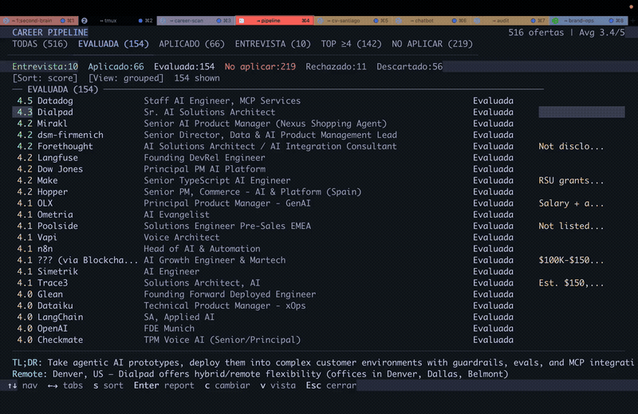
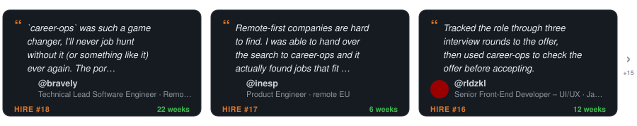
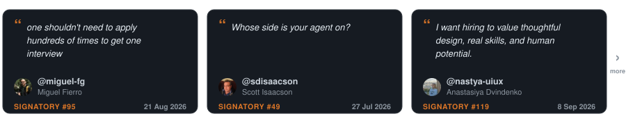
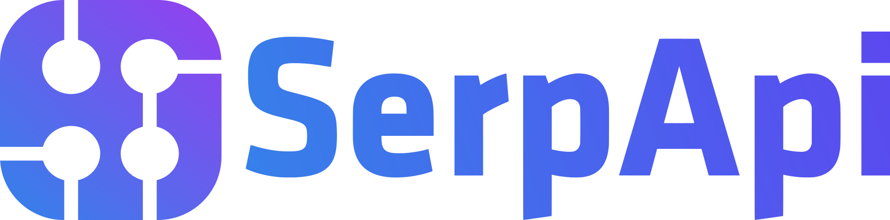
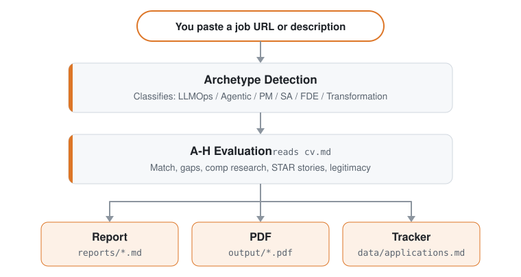

<p align="center"><picture><source media="(prefers-color-scheme: dark)" srcset="docs/wordmark-dark.svg"></picture></p>

<p align="center">AI-agenten for jobbsøk, med åpen kildekode.</p>

<p align="center">
  <a href="README.md">English</a> |
  <a href="README.es.md">Español</a> |
  <a href="README.de.md">Deutsch</a> |
  <a href="README.fr.md">Français</a> |
  <a href="README.pt-BR.md">Português (Brasil)</a> |
  <a href="README.ko-KR.md">한국어</a> |
  <a href="README.ja.md">日本語</a> |
  <a href="README.cn.md">简体中文</a> |
  <a href="README.zh-TW.md">繁體中文</a> |
  <a href="README.ua.md">Українська</a> |
  <a href="README.ru.md">Русский</a> |
  <a href="README.pl.md">Polski</a> |
  <a href="README.da.md">Dansk</a> |
  <a href="README.nb.md">Norsk (bokmål)</a> |
  <a href="README.ta.md">தமிழ்</a> |
  <a href="README.ar.md">العربية</a> |
  <a href="README.hi.md">हिन्दी</a> |
  <a href="README.tr.md">Türkçe</a> |
  <a href="README.vi.md">Tiếng Việt</a> |
  <a href="README.id.md">Bahasa Indonesia</a>
</p>

<!-- The non-breaking spaces (&nbsp;) and word joiners (&#8288;) below decide where each line wraps on a phone. Keep them when editing. -->

<p align="center"><a href="https://github.com/santifer"></a>&nbsp;&nbsp;Laget av <a href="https://github.com/santifer"><strong>@santifer</strong></a>, sammen&nbsp;med&nbsp;&nbsp;<a href="https://github.com/career-ops-hq/career-ops/blob/main/README.nb.md#builders"><picture><source media="(prefers-color-scheme: dark)" srcset="docs/builders-stack-dark.svg"></picture></a>&nbsp;&nbsp;<a href="https://github.com/career-ops-hq/career-ops/blob/main/README.nb.md#builders">700+ bidragsytere</a></p>

<p align="center">
<strong>Måneder med CV-er sendt ut i&nbsp;stillheten.</strong><br>
Så jeg bygde filteret jeg trengte.
</p>

<p align="center">
<strong>740&nbsp;annonser&nbsp;vurdert. 68&nbsp;søknader. 12&nbsp;intervjuer.&nbsp;1&nbsp;tilbud.</strong><br>
Jeg var den første brukeren. Jeg fikk&nbsp;jobben. Så&nbsp;delte&nbsp;jeg&nbsp;den&nbsp;som&nbsp;åpen&nbsp;kildekode.
</p>

<p align="center">
Lim inn en stilling. På din egen maskin forteller den deg om den fortsatt er&nbsp;åpen og om den passer&nbsp;deg.<br>
Den tilpasser CV-en din og skriver utkast til svarene&nbsp;dine. <strong>Du&nbsp;trykker&nbsp;på&nbsp;Send&nbsp;inn.</strong>
</p>

<p align="center">
  
</p>

<p align="center"><sub>Mitt eget jobbsøk, underveis, med&nbsp;grensesnittet&nbsp;på&nbsp;spansk.</sub></p>

<p align="center">
  Bedrifter bruker AI til å filtrere kandidater.<br>
  <strong>Jeg ga kandidatene AI, så&nbsp;de&nbsp;kan&nbsp;<em>velge</em>&nbsp;bedriftene.</strong>
</p>

<p align="center">
  Seks måneder senere <strong>sluttet jeg i den jobben.</strong><br>
  Nå bygger vi career-ops, så&nbsp;du&nbsp;kan&nbsp;lande&nbsp;din.
</p>

<p align="center"><a href="#din-tur">Prøv den på én&nbsp;stilling&nbsp;↓</a> · <a href="https://santifer.io/career-ops-system">Les hele&nbsp;historien&nbsp;→</a></p>
<p align="center"><sub>Vil du helst slippe terminalen? <a href="https://career-ops.org/waitlist?ref=readme-nb">Sett deg på ventelisten for en nettversjon&nbsp;→</a></sub></p>

<br>

<p align="center"><a href="HIRED.md"></a></p>

<p align="center">De som kom etter meg, skrev ned hvordan de fikk jobb.</p>

<p align="center">
  <a href="HIRED.md"></a>
</p>

<p align="center"><sub>Hvert kort er en offentlig issue du kan åpne. Fått jobben? <a href="https://github.com/career-ops-hq/career-ops/issues/new?template=i-got-hired.yml">Legg igjen kortet ditt →</a></sub></p>

<p align="center">⭐ <strong>Har career-ops hjulpet deg, hjelper en stjerne den neste med å finne&nbsp;den.</strong></p>

<br>

<p align="center">
  <a href="https://wired.com.gr/article/to-ai-ergaleio-pou-fernei-epanastasi-ston-tropo-pou-psachnoume-douleia/" rel="noopener noreferrer nofollow"><picture><source media="(prefers-color-scheme: dark)" srcset="docs/press/wired-dark.svg"></picture></a>
  &nbsp;&nbsp;&nbsp;&nbsp;
  <a href="https://www.businessinsider.com/how-i-built-tool-filter-job-listings-landed-head-ai-2026-4" rel="noopener noreferrer nofollow"><picture><source media="(prefers-color-scheme: dark)" srcset="docs/press/business-insider-dark.svg"></picture></a>
</p>

<p align="center">
  <a href="https://vercel.com/open-source-program"></a>
</p>

<p align="center">
  <a href="https://trendshift.io/repositories/25195" rel="noopener noreferrer"></a>
  &nbsp;&nbsp;&nbsp;&nbsp;
  <a href="https://www.producthunt.com/products/santifer-io?utm_source=badge-featured&utm_medium=badge" rel="noopener noreferrer"></a>
</p>

## Din tur

Lim inn én stilling du hadde tenkt å søke på i kveld. Kommer den tilbake med <em>ikke søk</em>, fikk du nettopp kvelden tilbake. Kommer den tilbake med en plan, vet du hva du skal gjøre videre.

```bash
npx @santifer/career-ops init
```

<p align="center"><sub>Åpen kildekode. Lokalt. I den AI-CLI-en du allerede bruker. <a href="docs/RUNNING_ON_A_BUDGET.md">Gratis og lokale modeller inkludert.</a></sub></p>


## Du trenger ikke søke alene

Stillheten etter at du har trykket på send, handler ikke om deg. Nok folk har sett det samme til å skrive ned praksisen, på seks linjer:

> Søk bedre, på færre. Signal fremfor volum. Bevis fremfor nøkkelord. Et menneske bestemmer. Lokalt først. Verdighet på begge sider av bordet.

<p align="center"><a href="https://career-ops.org/manifesto?utm_source=readme"></a></p>

<p align="center">Noen av dem, med egne ord.</p>

<p align="center">
  <a href="https://career-ops.org/manifesto?utm_source=readme"></a>
</p>

<p align="center"><sub>Hver underskrift er en commit du kan etterprøve. <a href="https://career-ops.org/manifesto?utm_source=readme">Les alle, eller legg til din →</a> · <a href="https://career-ops.org/manifesto?utm_source=readme#what-is-ai-job-search">Hva er AI-jobbsøk?</a></sub></p>

<br>

Rekruttering fikser ikke seg selv. Det kan de som går gjennom den, og de er allerede i rommet, der de sammenligner notater og fikser oppsettene til hverandre.

<a id="builders"></a>

<p align="center"><a href="CONTRIBUTING.md"></a></p>

[Det er her rettelsen blir skrevet](CONTRIBUTING.md). Et rom, ikke en klubb. **La oss bygge sammen.**

<p align="center"><a href="https://discord.gg/8pRpHETxa4"></a></p>

## Sponsorer

career-ops er gratis for kandidater, for alltid. Disse selskapene sponser prosjektet:

<p align="center">
  <a href="https://serpapi.com/career-ops-org" title="SerpApi"></a>
</p>

<p align="center"><strong>SerpApi</strong> · Build a portfolio project with live search data. SerpApi gives developers structured JSON/Markdown from Google Search, Maps, Shopping, and other engines through a simple API call.</p>

> Sponsing kjøper tydelig merket synlighet, aldri innflytelse: ingen sum endrer veikartet eller plasserer noe i produktet. Sponsorer vises aldri i vurderinger, rangeringer eller anbefalinger.

## Hva career-ops gjør for deg

Lim inn en stilling. Den forteller deg om kvelden er verdt det.

- **Fortsatt åpen?** Den sjekker at annonsen fortsatt er aktiv før du skriver et ord.
- **Ikke deg?** Den vurderer stillingen opp mot den faktiske CV-en din og ber deg hoppe over en svak match. Du kan overstyre den.
- **Verdt det?** Den skriver utkast til CV, søknadsbrev og svar. Du leser dem. Du sender dem.
- **Hvem bør jeg snakke med?** Den finner personen og skriver utkast til meldingen. Den sender den aldri.
- **Hvor havner alt?** Hver søknad blir liggende på maskinen din. Ingenting lastes opp til oss.
- **Hva bør jeg lære?** Etter en rekke avslag setter den navn på hullet.

De første kjøringene er ujevne. Den kjenner deg ikke ennå. Snakk med den: CV-en din, hva du vil, hva du sier nei til. Tenk på det som en rekrutterers første uke.

Første gang du starter den, spør den om alt dette i chatten. Ingenting å konfigurere for hånd.

## Hva career-ops ikke gjør

- **Sende inn en søknad automatisk.** Den skriver utkast til svaret i hvert felt; du går gjennom og klikker Send inn. Skriptet gjør aldri en POST (`prepare-application.mjs`).
- **Sende e-post.** Bare utkast. Det finnes ingen e-posttransport noe sted i kodebasen.
- **Ringe hjem.** Ingen telemetri, ingen backend hos oss. CV-en din går fra maskinen din til AI-leverandøren du har valgt, og ingen andre steder. Det eneste offentlige registeret er dette repositoryet: `HIRED.md` og issuene der.
- **Presse deg til å søke under 4,0/5.** Den ber deg la være. Du kan overstyre den, og den sier fra om det.

Den omformulerer CV-en din; den skal aldri dikte den opp. En kontroll i koden stopper en PDF med tall eller fakta som verken står i CV-en din eller i `article-digest.md`, men den kan ennå ikke vurdere enhver omformulering. Les hver CV før du sender den. Detaljer under [Ofte stilte spørsmål](#ofte-stilte-spørsmål).

## Funksjoner

| Funksjon                 | Beskrivelse                                                                                                                              |
| ------------------------ | ---------------------------------------------------------------------------------------------------------------------------------------- |
| **A-H-vurdering**        | Rollesammendrag, CV-match (med hvor mye hvert krav betyr for denne annonsen, og om vekten kom fra annonsens egen ordlyd, strukturen dens eller et anslag, merket per krav; et anslag kan aldri havne i toppbåndet), nivåstrategi, lønnsresearch, personalisering, intervjuforberedelse (STAR+R) -- pluss en troverdighetssjekk av annonsen i blokk G (er den fortsatt åpen, er den lagt ut på nytt: observasjoner, ikke dommer), og et arbeidstillatelsessignal som markerer en annonse som uttrykkelig ikke tilbyr visumsponsing, som en absolutt hindring |
| **Human-in-the-Loop**    | AI vurderer og anbefaler, du bestemmer og handler. Systemet sender aldri inn en søknad -- du har alltid siste ord <!-- hitl: absolute guarantee. Do not add "automatically", "by itself", "without your permission" or any other hedge when translating this row. -->               |
| **ATS-PDF-generering**   | ATS-lesbare CV-er tilpasset hver annonse ut fra din egen erfaring, i Space Grotesk + DM Sans-design                                       |
| **Søknadsbrevgenerator** | Researchbaserte søknadsbrev med speiling av nøkkelord, fire interaktive spørsmål om vinkling (hvorfor/problemer/tilnærming/tone), godkjenning av utkastet i chatten, og A4-PDF gjennom den samme HTML + Playwright-pipelinen som CV-ene. Lager utkast automatisk ved hver vurdering; fullfør og generer ved behov med `/career-ops cover` |
| **Mer enn CV-en**        | Selskapsresearch ([`deep`](modes/deep.md)) avdekker AI-strategi, nylige grep, ingeniørkultur og vinklingen profilen din bør ta. Kontaktsøk ([`contacto`](modes/contacto.md)) finner den ansettende lederen, rekruttereren eller kollegaen det er verdt å kontakte, og skriver et LinkedIn-utkast på ≤300 tegn tilpasset hver kontakttype. Utkast til formelle søknads-e-poster ([`email`](modes/email.md)) gjør en vurdert rapport eller en innlimt annonse om til emnelinje, brødtekst og sjekkliste for vedlegg, uten å sende, sende inn eller klikke på noe. Søknader setter deg i køen; research gir deg en samtale. |
| **Mønsteranalyse**       | Avslagsmønstre og andelen som går videre, per ATS-kanal (`analyze-patterns.mjs`), traktstatistikk for hele søket (`stats.mjs`), oppdagelse av annonser som legges ut på nytt, et mulig tegn på en spøkelsesstilling (`detect-reposts.mjs`) |

<details>
<summary><b>Alt annet den gjør</b></summary>

| Funksjon                 | Beskrivelse                                                                                                                              |
| ------------------------ | ---------------------------------------------------------------------------------------------------------------------------------------- |
| **Auto-pipeline**        | Lim inn en URL, få en fullstendig vurdering + PDF + rad i trackeren                                                                      |
| **Historiebank for intervjuer** | Samler STAR+Reflection-historier på tvers av vurderinger -- 5-10 hovedhistorier du kan tilpasse atferdsspørsmålene du får         |
| **Forhandlingsmanus**    | Rammeverk for lønnsforhandling, svar på geografisk lønnsrabatt, bruk av konkurrerende tilbud                                             |
| **Utkast til søknads-e-poster** | Formelle e-poster til rekrutterer, via anbefaling eller som åpen søknad, fra en rapport eller en innlimt annonse, med emnelinje, sjekkliste for vedlegg, dokumenterte matchpunkter og en kontaktblokk fra profilen din. Bare utkast -- career-ops sender, sender inn eller klikker aldri på noe. |
| **Portalskanner**        | 100+ forhåndskonfigurerte selskaper (Anthropic, OpenAI, ElevenLabs, Retool, n8n...) + egne nettsøk på tvers av Ashby, Greenhouse, Lever, Wellfound |
| **Finn finansierte selskaper** | Skriptet `npm run company:funded` (gå gjennom først) viser nylig finansierte selskaper og kildediagnostikk fra strukturerte offentlige feeder, uten å endre dataene dine |
| **Batchbehandling**      | Parallell vurdering med headless CLI-workers (`claude -p` / `opencode run`)                                                              |
| **Dashbord-TUI**         | Terminalgrensesnitt for å bla gjennom, filtrere og sortere pipelinen din                                                                 |
| **Pipeline-integritet**  | Automatisk sammenslåing, duplikatfjerning, normalisering av status, helsesjekker                                                         |
| **Intervjupakke**        | Tidsblokkerte forberedelsesplaner, øvingsøkter med tilbakemelding, debrief etter intervjuet ([`interview/`](modes/interview/README.md)), og en detektor for røde flagg hos arbeidsgiveren ([`interview-redflag`](modes/interview-redflag.md)) |
| **Tilbudsfasen**         | Hjelp til å lese kontrakten -- gjennomgang klausul for klausul pluss en spørsmålsliste til advokaten ([`offer-prep`](modes/offer-prep.md)) -- og en analyse av gapet mellom ønsket, annonsert og faktisk lønn (`salary-gap.mjs`) |
| **Oppfølging og svar**   | Beregning av oppfølgingskadens og forhåndsutfylte påminnelser (`followup-cadence.mjs`, `followup-seed.mjs`); slå dem av med `follow_ups.enabled: false` i `config/profile.yml`; klassifisering av svar fra arbeidsgivere til oppdateringer i trackeren ([`reply-watch`](modes/reply-watch.md)) |
| **Pluginsystem**         | Valgfrie integrasjoner (Gmail, Notion, Apify + et community-register), slått av som standard -- se [docs/PLUGINS.md](docs/PLUGINS.md)   |
| **LinkedIn-jobbvarsler** | Lim inn en e-post med LinkedIn-jobbvarsel i dashbordet eller med `node linkedin-import.mjs`. Ingen Google-konto. Se [docs/LINKEDIN_JOBS.md](docs/LINKEDIN_JOBS.md) |

</details>

## Slik fungerer det

<p align="center"><picture><source media="(prefers-color-scheme: dark)" srcset="docs/how-it-works-dark.svg"></picture></p>

## Hurtigstart

**Raskeste vei, én kommando:**

```bash
npx @santifer/career-ops init
```

> 💡 `npx` følger med [Node.js](https://nodejs.org): det kjører installasjonsprogrammet én gang,
> uten å installere noe globalt. Ikke Node ennå? Installer det først.
> (Bruker du allerede Claude Code / Codex CLI? Da har du det allerede.)

Dette kloner siste utgivelse til `./career-ops` og installerer avhengighetene. Deretter:

```bash
cd career-ops
claude   # eller codex / qwen / opencode / agy / grok — åpne AI-CLI-en din her
```

**Første gang du starter, tar career-ops deg gjennom oppsettet (CV-en din, profilen og målrollene) bare ved at dere chatter. Ingenting å redigere for hånd.**

<details>
<summary><b>Vil du heller sette det opp manuelt? (git clone)</b></summary>

```bash
git clone https://github.com/career-ops-hq/career-ops.git
cd career-ops && npm install
npx playwright install chromium   # trengs bare for PDF-generering
# På en Linux-distribusjon som ikke er Debian/Ubuntu (Fedora, Arch, ...) installerer
# ikke linjen over Chromiums systembiblioteker — installer dem selv med
# distribusjonens pakkebehandler hvis PDF-genereringen ikke får startet nettleseren
# (Playwrights egen dokumentasjon lister de nødvendige bibliotekene per plattform).

# 2. Åpne AI-CLI-en din i denne mappen. Første gang tar den deg
#    gjennom oppsettet (CV-en din, profilen og målrollene) i chatten
claude   # eller codex / opencode / qwen / agy / grok

# Be så CLI-en din tilpasse systemet til deg:
# «Endre arketypene til backend-roller»
# «Bruk de norske modene under modes/nb/»
# «Legg til disse 5 selskapene i portals.yml»
# «Oppdater profilen min med denne CV-en jeg limer inn»

# 3. Ta det i bruk
# Lim inn en URL eller teksten fra en stillingsannonse for å starte auto-pipeline.
# Alle andre modes, og hvordan du ber om dem i CLI-en din: se Bruk nedenfor.
```

LinkedIn-jobbvarsler: lim inn e-posten. Ingen Google-konto. Se [docs/LINKEDIN_JOBS.md](docs/LINKEDIN_JOBS.md).

</details>

### Global installasjon

```bash
npm i -g @santifer/career-ops
```

Dette installerer `career-ops`-programmet globalt, så du kan kjøre `career-ops init [folder]` uten `npx`. `init` er den eneste kommandoen: den setter opp et arbeidsområde, og alt etter det skjer inne i AI-kode-CLI-en din (se Bruk nedenfor), ikke gjennom dette programmet.

**Hvilken bør du bruke?**
- `npx @santifer/career-ops init`: best første gang; oppretter en egen prosjektmappe.
- `npm i -g @santifer/career-ops`: hvis du heller vil skrive `career-ops init` enn `npx`-varianten. Den legger ikke til andre kommandoer.

### Andre måter å kjøre den på

- **Fra hvilken som helst mappe, som Claude Code-plugin:** [docs/CLAUDE_PLUGIN.md](docs/CLAUDE_PLUGIN.md).
- **Uten AI-CLI:** frittstående skript for Gemini, Ollama og OpenAI-kompatible modeller vurderer en annonse på egen hånd. Se [docs/SCRIPTS.md](docs/SCRIPTS.md#geminieval--ollamaeval--openaieval).

> **Systemet er laget for å tilpasses av AI-kode-CLI-en din selv.** Modes, arketyper, vekter i poengsummen, forhandlingsmanus -- bare be den endre dem. Den leser de samme filene den bruker, så den vet nøyaktig hva den skal redigere.

Se [docs/SETUP.md](docs/SETUP.md) for den fullstendige oppsettsguiden (inkludert [skanning gjennom en utgående proxy](docs/SETUP.md#scanning-through-an-outbound-proxy)), [docs/SUPPORTED_CLIS.md](docs/SUPPORTED_CLIS.md) for hvordan du kjører career-ops i hver støttede CLI, med headless-kommandoen der den finnes, [docs/RUNNING_ON_A_BUDGET.md](docs/RUNNING_ON_A_BUDGET.md) for å kjøre career-ops billig med egne eller lokale modeller (og [docs/FREE_TIER.md](docs/FREE_TIER.md) for å kjøre den helt gratis på gratisnivået til Antigravity CLI), [docs/AUTOMATION.md](docs/AUTOMATION.md) for planlagte, gjentakende skanninger og en oppskrift på triage til kortliste uten tokens, [docs/KEEPING_PORTALS_LIVE.md](docs/KEEPING_PORTALS_LIVE.md) for å holde selskapslisten oppdatert, [docs/BACKUP_STRATEGIES.md](docs/BACKUP_STRATEGIES.md) for sikkerhetskopi av CV, tracker og rapporter, [docs/APPLY_AUTOFILL.md](docs/APPLY_AUTOFILL.md) for detaljer om automatisk utfylling av ATS-skjemaer, [docs/LINKEDIN_JOIN.md](docs/LINKEDIN_JOIN.md) for å krysssjekke en eksport av LinkedIn-kontaktene dine mot selskapene i trakten din, og [docs/FAQ.md](docs/FAQ.md) for svar på vanlige spørsmål om oppsett, blant annet [hvordan opphavsmerking av historier hindrer oppdiktede tall](docs/FAQ.md#why-does-career-ops-refuse-to-use-a-number-from-my-story-bank). Designprinsippene står i [ARCHITECTURE.md](ARCHITECTURE.md); kjøretidsflytene i [docs/ARCHITECTURE.md](docs/ARCHITECTURE.md).

## Bruk

Lim inn en URL eller en stillingsbeskrivelse i AI-CLI-en din. career-ops sjekker at en lenket annonse fortsatt er aktiv (innlimt tekst har ingen lenke å sjekke), vurderer den opp mot CV-en din, skriver en rapport, tilpasser CV-en din (PDF som standard) og legger til en rad i trackeren. Det dekker de fleste dager. Alt annet er en mode du ber om ved navn. Kan ikke annonsen leses, stopper pipelinen og ber deg lime inn teksten eller dele et skjermbilde.

### Slik ber du om en mode

| CLI | Slik ber du om `scan` |
| --- | --- |
| Claude Code, OpenCode, Antigravity CLI (`agy`), Grok Build CLI | `/career-ops scan` |
| Pi | `/skill:career-ops scan` |
| Codex, Qwen, Cursor eller en annen støttet CLI | Vanlig språk: «Kjør career-ops scan-moden» |

`/career-ops` uten noe etter viser kommandomenyen i CLI-ene som bruker den. Vanlig språk fungerer i alle støttede CLI-er. Som Claude Code-plugin er kommandoen `/career-ops:career-ops`.

Alle deler én ruter, `.agents/skills/career-ops/SKILL.md`, og de samme `modes/*.md`-filene, så alle CLI-er ruter en forespørsel likt (modes som bruker nettleseren mye, trenger også Playwright-verktøy). Skråstrekkommandoer er ikke garantert i Codex: spør med vanlig språk, eller kjør én prompt headless med `codex exec "Evaluate this JD with career-ops auto-pipeline: https://company.com/jobs/123"` ([docs/CODEX.md](docs/CODEX.md)). Hvordan du kjører den i hver støttede CLI, headless-kommandoer der en CLI har det, og oppsettsnotater per CLI står i [docs/SUPPORTED_CLIS.md](docs/SUPPORTED_CLIS.md).

### Kommandoene til hverdags

| Kommando | Hva den gjør |
| --- | --- |
| *lim inn en URL eller en annonse* | Hele pipelinen: sjekk av om annonsen er aktiv (bare URL-er), A-G-vurdering pluss H ved høy score, rapport, tilpasset CV (PDF som standard), rad i trackeren |
| `scan` | Skann portalene dine for nye annonser og legg dem i innboksen (`data/pipeline.md`) |
| `pipeline` | Gå gjennom URL-ene som venter i innboksen (standard- og premium-nivået kan hoppe over åpenbare mismatcher) |
| `apply` | Fyll ut et søknadsskjema sammen med deg, felt for felt. Den stopper før Send inn |
| `tracker` | Hvor hver søknad står |
| `followup` | Hvilke søknader som skal følges opp, med utkast |

<details>
<summary><b>Alle kommandoer, etter fase i jobbsøket</b></summary>

`oferta`, `ofertas` og `contacto` beholder de opprinnelige spanske navnene: tilbud, tilbud (flertall), kontakt.

**Finn stillinger**

| Kommando | Hva den gjør |
| --- | --- |
| [`scan`](modes/scan.md) | Skann portaler og finn nye annonser |
| [`discover`](modes/discover.md) | Gjør en liste med selskapsnavn om til ATS-tavler som kan skannes. Viser bare en forhåndsvisning som standard; legger dem til i `portals.yml` bare med `--write` (uten tokens) |
| [`pipeline`](modes/pipeline.md) | Behandle ventende URL-er fra innboksen (`data/pipeline.md`) |
| [`triage`](modes/triage.md) | Rask første vurdering (søk/ikke søk) ut fra `modes/_brief.md`, før en full vurdering (skriver ingen filer) |
| [`batch`](modes/batch.md) | Vurder mange annonser med headless-workers (parallelt med Claude, én om gangen med andre CLI-er) |
| [`titles`](modes/titles.md) | Foreslå beslektede stillingstitler ut fra CV-en din for å utvide søket |

**Vurder en stilling**

| Kommando | Hva den gjør |
| --- | --- |
| *lim inn en URL eller en annonse* | [Auto-pipeline](modes/auto-pipeline.md): vurdering + rapport + tilpasset CV (PDF som standard) + rad i trackeren |
| [`oferta`](modes/oferta.md) | Bare vurdering, blokk A til G pluss H ved høy score (ingen PDF) |
| [`ofertas`](modes/ofertas.md) | Sammenlign og ranger flere tilbud |
| [`deep`](modes/deep.md) | Prompt for grundig research om selskapet |
| [`eu-swe`](modes/regional/eu-swe.md) | Kalibrer en europeisk søknad innen programvareutvikling før CV, søknad eller intervju |

**Søk**

| Kommando | Hva den gjør |
| --- | --- |
| [`pdf`](modes/pdf.md) | ATS-optimalisert CV som PDF |
| [`ats`](modes/ats.md) | Sjekk av hvor ATS-vennlig en generert CV er: poengsum og problemer som kan rettes |
| [`text`](modes/text.md) | Tilpasset CV som markdown (speiler `cv.md`, ingen PDF) |
| [`latex`](modes/latex.md) | Eksporter CV-en som LaTeX/Overleaf `.tex` |
| [`latex-tex`](modes/latex-tex.md) | Tilpass din egen `resume.tex` direkte (valgfritt; `cv.md` forblir standard) |
| [`cover`](modes/cover.md) | Søknadsbrev, fra en innlimt annonse eller en vurdert rapport (`cover {slug}`) |
| [`email`](modes/email.md) | Utkast til formell søknads-e-post. Bare utkast: sender, sender inn eller klikker aldri |
| [`contacto`](modes/contacto.md) | Finn den ansettende lederen, en rekrutterer eller en kollega, og skriv utkast til en LinkedIn-melding |
| [`apply`](modes/apply.md) | Søknadsassistent i sanntid (Playwright fra denne checkouten). Sender ikke inn |

**Intervju**

| Kommando | Hva den gjør |
| --- | --- |
| [`interview-prep`](modes/interview-prep.md) | Selskapsspesifikt dokument for intervjuforberedelse |
| [`interview/plan`](modes/interview/plan.md) | Tidsblokkert forberedelsesplan for et kommende intervju |
| [`interview/practice`](modes/interview/practice.md) | Øvingsintervju, ett spørsmål om gangen, med tilbakemelding |
| [`interview/debrief`](modes/interview/debrief.md) | Debrief etter intervjuet: tett hull, forutsi neste runde |
| [`interview-redflag`](modes/interview-redflag.md) | Analyser varselsignalene hos en arbeidsgiver før du takker ja |

**Etter at du har søkt**

| Kommando | Hva den gjør |
| --- | --- |
| [`tracker`](modes/tracker.md) | Oversikt over status for søknadene |
| [`followup`](modes/followup.md) | Oppfølgingskadens: marker søknader som er over tiden, lag utkast |
| [`reply-watch`](modes/reply-watch.md) | Klassifiser svar fra arbeidsgivere og foreslå oppdateringer i trackeren |
| [`outcome`](modes/outcome.md) | Registrer utfallet av en søknad og arkiver filene som hører til |
| [`offer-prep`](modes/offer-prep.md) | Les et mottatt tilbud eller en kontrakt sammen med deg: gjennomgang av klausulene og spørsmål til en advokat (ikke juridisk rådgivning) |

**Profilen og CV-en din**

| Kommando | Hva den gjør |
| --- | --- |
| [`interview`](modes/interview.md) | Profiloppsett: et interaktivt intervju om erfaringen din som bygger CV-en og profilen din (ikke intervjutrening) |
| [`intake`](modes/intake.md) | Bygg eller utvid profilen din fra filer i `documents/` (hoved-CV, LinkedIn-eksport). Ingenting skrives uten at du bekrefter |
| [`master-profile`](modes/master-profile.md) | Importer, gå gjennom og valider Master Career Profile, og klargjør utvalgte fakta som CV-punkter |
| [`add`](modes/add.md) | Legg til et prosjekt, en artikkel eller en rolle i CV-en (hent, forhåndsvis, bekreft) |
| [`expand`](modes/expand.md) | Finn kompetanse som mangler i CV-en din, ut fra profillenkene dine |
| [`retro`](modes/retro.md) | Gå gjennom denne økten og ta vare på det du lærte den, som regler (skriver bare dem du godtar) |

**Bedre treffsikkerhet**

| Kommando | Hva den gjør |
| --- | --- |
| [`patterns`](modes/patterns.md) | Analyser avslagsmønstre og spiss målrettingen |
| [`calibrate`](modes/calibrate.md) | Sjekk om vurderingsscorene dine forutsier de faktiske resultatene. Rådgivende: endrer aldri poengsettingen |
| [`upskill`](modes/upskill.md) | Analyse av kompetansegap på tvers av de vurderte rapportene dine |
| [`training`](modes/training.md) | Vurder et kurs eller en sertifisering opp mot North Star-en din |
| [`project`](modes/project.md) | Vurder en idé til et porteføljeprosjekt |

**System**

| Kommando | Hva den gjør |
| --- | --- |
| [`agent-inbox`](modes/agent-inbox.md) | Legg forespørsler i kø til neste økt, og gå gjennom dem da (`data/agent-inbox.md`). `inbox` fungerer også |
| [`update`](modes/update.md) | Oppdater systemfilene til career-ops, med forhåndsvisning av diffen og kompatibilitetssjekk |

</details>

## Forhåndskonfigurerte portaler

Skanneren kommer med **100+ selskaper** klare til skanning og **35+ søk** på tvers av de store jobbportalene. Kopier `templates/portals.example.yml` til `portals.yml` og legg til dine egne:

**AI-laboratorier:** Anthropic, OpenAI, Mistral, Cohere, LangChain, Pinecone
**Stemme-AI:** ElevenLabs, PolyAI, Parloa, Hume AI, Deepgram, Vapi, Bland AI
**AI-plattformer:** Retool, Airtable, Vercel, Temporal, Glean, Arize AI
**Kundesenter:** Ada, LivePerson, Sierra, Decagon, Talkdesk, Genesys
**Enterprise:** Salesforce, Twilio, Gong, Dialpad
**LLMOps:** Langfuse, Weights & Biases, Lindy, Cognigy, Speechmatics
**Automatisering:** n8n, Zapier, Make.com
**Europa:** Factorial, Attio, Tinybird, Clarity AI, Travelperk

**Jobbportaler det søkes i:** 55+ leverandørmoduler dekker ATS-API-er, feeder for hele portaler, XML/RSS-feeder, markdown-feeder og lokale parsere. Se [Støttede jobbportaler](docs/SUPPORTED_JOB_BOARDS.md) for hele tabellen.

Hold listen oppdatert: `portals.yml` er laget for å holdes levende, ikke for å settes opp én gang. Se [Keeping portals.yml live](docs/KEEPING_PORTALS_LIVE.md) for husregelen som legger til nye selskaper automatisk, og kommandoene som validerer filen etter hver endring.

Som standard stoler `node scan.mjs` (også `npm run scan`) på det hver ATS-feed returnerer. Noen selskaper lar utdaterte annonser bli liggende i det offentlige API-et lenge etter at stillingen er lukket, så de utløpte oppføringene kan sive inn i `pipeline.md`. Legg til `--verify` for å starte Playwright etter API-runden og sortere ut utløpte annonser før de havner i pipelinen:

```bash
node scan.mjs --verify          # oppdagelse uten tokens + Playwright-sjekk av om annonsen er aktiv
```

Verifiseringen går sekvensielt og bare mot nye annonser (etter duplikatfjerning), så kostnaden holder seg begrenset.

## Dashbord-TUI

Det innebygde terminaldashbordet lar deg bla visuelt gjennom pipelinen:

```bash
npm run serve:dashboard   # start TUI-en
npm run build:dashboard   # valgfritt: bygg den frittstående binærfilen
```

Funksjoner: 10 filterfaner, 8 sorteringsmåter, gruppert/flat visning, forhåndsvisninger som lastes ved behov, statusendringer direkte i listen.

Det finnes også et **eksperimentelt nettgrensesnitt** (alfa og valgfritt: ingenting kjører med mindre du starter det): se [`web/README.md`](web/README.md).

## Prosjektstruktur

```
career-ops/
├── AGENTS.md                    # Kanoniske agentinstruksjoner (alle CLI-er)
├── CLAUDE.md                    # Claude Code-wrapper (importerer AGENTS.md)
├── CODEX.md                     # Codex-wrapper (importerer AGENTS.md)
├── OPENCODE.md                  # OpenCode-wrapper (importerer AGENTS.md)
├── GEMINI.md                    # Eldre no-op-vern mot duplisert kontekst i Antigravity
├── cv.md                        # CV-en din (opprett denne)
├── article-digest.md            # Proof points fra porteføljen din (valgfri)
├── config/
│   └── profile.example.yml      # Mal for profilen din
├── modes/                       # Skill-modes
│   ├── _shared.md               # Felles kontekst (systemfil; lokal endring beholdes med mindre apply --force)
│   ├── _profile.md              # Arketypene og vinklingen din (tilpass denne)
│   ├── oferta.md                # Enkeltvurdering
│   ├── pdf.md                   # PDF-generering
│   ├── cover.md                 # Søknadsbrev
│   ├── email.md                 # Utkast til formelle søknads-e-poster
│   ├── scan.md                  # Portalskanner
│   ├── batch.md                 # Batchbehandling
│   └── ...
├── templates/
│   ├── cv-template.html         # ATS-optimalisert CV-mal
│   ├── portals.example.yml      # Mal for skannerkonfigurasjon
│   └── states.yml               # Kanoniske statuser
├── batch/
│   ├── batch-prompt.md          # Selvstendig worker-prompt
│   └── batch-runner.sh          # Orkestreringsskript
├── dashboard/                   # Go-TUI for pipelinen
├── data/                        # Sporingsdataene dine (gitignored)
├── reports/                     # Vurderingsrapporter (gitignored)
├── output/                      # Genererte PDF-er (gitignored)
├── fonts/                       # Space Grotesk + DM Sans
├── docs/                        # Oppsett, tilpasning, budsjettguide, arkitektur
└── examples/                    # Eksempel-CV, -rapport, proof points
```

## Ekstern datamappe (valgfritt)

Som standard ligger dataene i brukerlaget (som `cv.md`, `portals.yml` og mappene `data/`, `reports/` og `output/`) i prosjektets rotmappe.

For å skille de personlige dataene dine fra koden (så det blir enklere å bytte branch, hente oppdateringer eller teste flere profiler) kan du sette opp en ekstern datamappe, i denne rekkefølgen:

1. **Miljøvariabler:** Sett miljøvariabelen `CAREER_OPS_ROOT` eller `CAREER_OPS_DATA_DIR`:
   ```bash
   export CAREER_OPS_ROOT=~/my-career-data
   ```
2. **Markørfil:** Opprett en `.career-ops-data`-fil i roten av repositoryet med stien til datamappen din.
3. **Standard:** Roten av repositoryet.

Når mappen er bestemt, leses og skrives alle brukerfiler relativt til den, mens promptfiler og skript fortsatt løses relativt til repositoryet.

- **Overstyre trackeren:** Du kan også sette `CAREER_OPS_TRACKER` for å overstyre stien til søknadstrackeren direkte.
- **Skriving:** Alle skriveoperasjoner (som sammenslåinger) går kanonisk til `{DATA_ROOT}/data/applications.md`.
- **Skannerkonfigurasjon:** `portals.yml` leses og valideres i `{DATA_ROOT}/portals.yml`, så `node validate-portals.mjs` sjekker den samme filen som `scan.mjs` leser.
- **Genererte dokumenter:** tilpassede CV-er og søknadsbrev skrives under `{DATA_ROOT}/output/`, og PDF-manifestet som kobler dem til en rapport, ligger i `{DATA_ROOT}/data/pdf-index.tsv`. Så lenge `CAREER_OPS_TRACKER` ikke er satt, er trackerens arbeidsområde, som avgrenser disse skrivingene, datamappen og ikke checkouten.
- **PDF-er med overstyrt tracker:** `generate-pdf.mjs` løser `CAREER_OPS_TRACKER` før den utleder arbeidsområdet, så når overstyringen er satt, er arbeidsområdet mappen som inneholder trackeren (eller mappen over, når trackeren ligger i en `data/`-mappe). CV-ens HTML og hver PDF må da ligge innenfor det arbeidsområdet, og manifestet flytter til `data/pdf-index.tsv` der. Søknadsbrev skrives fortsatt til `{DATA_ROOT}/output/`, så de avvises når den mappen ligger utenfor trackerens arbeidsområde.
- **Kodelaget blir der det er:** `node_modules/`, `providers/`, `modes/` og selve skriptene løses alltid mot repositoryet, aldri mot datamappen.

Go-dashbordets TUI, Node.js-skriptene og AI-agentens modes følger alle denne rekkefølgen automatisk.


## Teknologi


- **Agent**: AI-kode-CLI med felles skills og modes (`AGENTS.md` + CLI-wrapper)
- **PDF**: Playwright + HTML-mal
- **Søknadsbrev**: HTML-mal + Playwright (A4-PDF, samme pipeline som CV-ene)
- **Skanner**: Playwright + Greenhouse API + WebSearch
- **Dashbord**: Go + Bubble Tea + Lipgloss (Catppuccin Mocha-tema)
- **Data**: Markdown-tabeller + YAML-konfigurasjon + TSV-batchfiler

<p align="center">
  <a href="https://github.com/career-ops-hq/career-ops/releases/latest"></a>
</p>

<p align="center">
  <a href="https://claude.com/claude-code"></a>
</p>

<p align="center">
  <sub>Kjører også i alle CLI-er som følger agent skill-standarden. Se <a href="docs/SUPPORTED_CLIS.md">støttede CLI-er</a>.</sub><br>
  
  
  
  
  
  
  
  
  
  
  <br>
  
  
  
  
  
  <a href="TRADEMARK.md"></a>
</p>

## Også åpen kildekode

- **[cv-santiago](https://github.com/santifer/cv-santiago)** -- Porteføljenettstedet (santifer.io) med AI-chatbot, LLMOps-dashbord og casestudier. Trenger du en portefølje å vise frem ved siden av jobbsøket, kan du forke det og gjøre det til ditt eget.

## Ofte stilte spørsmål

**Hva er career-ops?**
career-ops ([career-ops.org](https://career-ops.org), også kjent som **careerops**) er et AI-jobbsøk med åpen kildekode som kjører lokalt i AI-kode-CLI-en din (Claude Code, Codex, OpenCode og andre) og overlater hver beslutning til deg. Den vurderer stillingsannonser opp mot CV-en din, genererer ATS-tilpassede PDF-er, finner rett person å kontakte og holder orden på alt på ett sted: du har alltid siste ord. Den er den første referanseimplementeringen av [CareerOps-manifestet](https://career-ops.org/manifesto).

**Kan den tilpassede CV-en finne på ting?**
Det skal den ikke, og promptene sier det: omformuler, aldri dikt opp. `generate-pdf` blokkerer en CV med tall eller fakta som mangler i kildene dine, med mindre du sender med `--skip-fact-check`. `pdf`-moden kjører også `cv-title-check.mjs`, som sammenligner hver stillingstittel i den tilpassede CV-en med tittelen cv.md gir den samme jobben (matchet på selskap og datoer), og spør deg om en avvikende tittel skal beholdes eller settes tilbake. Den advarer i stedet for å blokkere, fordi en omformulert tittel noen ganger er ditt valg. Ingenting vurderer omformuleringer ennå: [#1411](https://github.com/career-ops-hq/career-ops/issues/1411) (en troskapssjekk som blokkerer ved avvik) følger opp det. Til da: les hver CV før du sender den. [Den juridiske ansvarsfraskrivelsen](LEGAL_DISCLAIMER.md) sier det samme med flere ord.

**Kan jeg kjøre career-ops gratis, eller på en billigere / lokal modell?**
Ja. career-ops er CLI-uavhengig og kjører på gratis og lokale modeller (gratismodeller på OpenRouter, Ollama eller et hvilket som helst OpenAI-kompatibelt endepunkt), så du er ikke bundet til et betalt abonnement. Se [docs/RUNNING_ON_A_BUDGET.md](docs/RUNNING_ON_A_BUDGET.md) for hele oppsettet.

**Jeg betaler for Claude Pro/Max, men career-ops bruker opp API-kreditter. Hvorfor?**
Fordi en `ANTHROPIC_API_KEY` i miljøet ditt går foran abonnementet du er logget inn med: CLI-en bruker nøkkelen og fakturerer per token. Kjør `echo $ANTHROPIC_API_KEY`, og skriver den ut noe, fjern den fra shell-profilen din, start terminalen på nytt og kjør `/login`. Batchmodus er unntaket, siden `claude -p`-workers ikke bruker den interaktive innloggingen: kjør `claude setup-token` én gang og eksporter resultatet som `CLAUDE_CODE_OAUTH_TOKEN`. Hele gjennomgangen står i [docs/RUNNING_ON_A_BUDGET.md](docs/RUNNING_ON_A_BUDGET.md#2b-already-paying-for-a-subscription-make-sure-you-are-using-it).

**Hvilke AI-CLI-er fungerer career-ops med?**
career-ops kjører i alle de store AI-kode-CLI-ene (Claude Code, Codex, Gemini / Antigravity, OpenCode, Grok, Qwen med flere) gjennom den åpne Agent Skill Standard, så den er aldri låst til én leverandør. Bruk CLI-en du allerede har.

**Hvordan installerer jeg career-ops på Windows?**
career-ops kjører på Windows. Plattformspesifikt oppsett og de kjente fallgruvene (oppdagelse av Git Bash, linjeskift, Oppgaveplanlegging) står i [docs/WINDOWS.md](docs/WINDOWS.md). Feiler skills under installasjonen med en symlink-feil, står løsningen i [docs/FAQ.md](docs/FAQ.md). Alle trinnene står i [docs/SETUP.md](docs/SETUP.md). På NixOS bruker du flake-dev-shellet i stedet for `npx playwright install`; se [docs/NIXOS.md](docs/NIXOS.md).

**Søker career-ops på jobber for meg automatisk?**
Nei. career-ops er et filter, ikke en masseutsender av søknader. AI-en vurderer, rangerer og skriver utkast; du går gjennom og bestemmer. Den skriver utkast og fyller ut; den sender aldri inn. Du trykker på Send inn. Denne human-in-the-loop-utformingen er hele poenget.

**Er career-ops gratis og åpen kildekode?**
Ja. career-ops er gratis og åpen kildekode, og for kandidaten vil det alltid være det. Den er den første referanseimplementeringen av [CareerOps-manifestet](https://career-ops.org/manifesto). Les det, og hvis det sier det du tror på, så skriv under.

## Om forfatteren

Jeg er [Santiago Fernández de Valderrama Aparicio](https://santifer.io/about) (santifer), tidligere gründer: jeg bygde og solgte en bedrift som fortsatt drives med navnet mitt på. Jeg bygde career-ops for å styre mitt eget jobbsøk, og det virket: det ga meg en stilling som Head of Applied AI. Seks måneder senere sluttet jeg i den stillingen for å bygge career-ops på heltid.

Nysgjerrig på hvordan et repository av denne størrelsen vedlikeholdes med en flåte av AI-agenter og et menneske som bestemmer hver merge? Les [Agentic maintenance: how career-ops is run by a fleet of AI agents](https://santifer.io/ai-agent-fleet).

Porteføljen min og andre prosjekter med åpen kildekode → [santifer.io](https://santifer.io)

Wikidata: [Santiago Fernández de Valderrama Aparicio](https://www.wikidata.org/wiki/Q138710224) · [career-ops](https://www.wikidata.org/wiki/Q139007988).

## Ansvarsfraskrivelse

**career-ops er et lokalt verktøy med åpen kildekode, IKKE en driftet tjeneste.** Ved å bruke denne programvaren erkjenner du følgende:

1. **Du kontrollerer dataene dine.** CV-en din, kontaktinformasjonen og personopplysningene dine blir på maskinen din og sendes direkte til AI-leverandøren du velger (Anthropic, OpenAI osv.). Vi samler ikke inn, lagrer ikke og har ikke tilgang til noen av dataene dine.
2. **Du kontrollerer AI-en.** Standardpromptene instruerer AI-en om ikke å sende inn søknader automatisk, men AI-modeller kan oppføre seg uforutsigbart. Endrer du promptene eller bruker andre modeller, gjør du det på egen risiko. **Gå alltid gjennom AI-generert innhold for å sjekke at det stemmer, før du sender inn.**
3. **Du følger tredjeparters vilkår.** Du må bruke dette verktøyet i samsvar med bruksvilkårene til karriereportalene du bruker (Greenhouse, Lever, Workday, LinkedIn osv.). Ikke bruk verktøyet til å spamme arbeidsgivere eller overbelaste ATS-systemer.
4. **Ingen garantier.** Vurderinger er anbefalinger, ikke sannheter. AI-modeller kan hallusinere ferdigheter eller erfaring. Forfatterne er ikke ansvarlige for utfallet av jobbsøket, avslåtte søknader, kontobegrensninger eller andre konsekvenser.

Se [LEGAL_DISCLAIMER.md](LEGAL_DISCLAIMER.md) for alle detaljer. Programvaren leveres under [MIT-lisensen](LICENSE) «som den er», uten garanti av noe slag.

## Bidragsytere

<a href="https://github.com/career-ops-hq/career-ops/graphs/contributors">
  
</a>

Alle som har levert kode, dokumentasjon, oversettelser eller tester, står i
[CONTRIBUTORS.md](CONTRIBUTORS.md), også bidrag uten kode, som
grafen over ikke kan vise.

Fikk du jobb med career-ops? [Del historien din!](https://github.com/career-ops-hq/career-ops/issues/new?template=i-got-hired.yml)

## Lisens og varemerke

Koden er lisensiert under [MIT](LICENSE). Navnet og merkevaren
«career-ops» er underlagt [varemerkepolicyen](TRADEMARK.md), som er romslig
for bruk i fellesskapet og forbeholder kommersiell produktnavngivning og
anbefalinger.

## Stjernehistorikk

<p align="center">
  <a href="https://warpchart.dev/hq">
    <picture>
      <source media="(prefers-color-scheme: dark)" srcset="https://warpchart.dev/api/chart?theme=dark&v=3">
      
    </picture>
  </a>
</p>

<p align="center"><sub>Laget og vedlikeholdt av <a href="https://santifer.io">Santiago Fernández de Valderrama Aparicio</a> (<a href="https://github.com/santifer">@santifer</a>)</sub></p>

## Ta kontakt

[](https://santifer.io)
[](https://linkedin.com/in/santifer)
[](https://x.com/santifer)
[](https://discord.gg/8pRpHETxa4)
[](mailto:hi@santifer.io)
