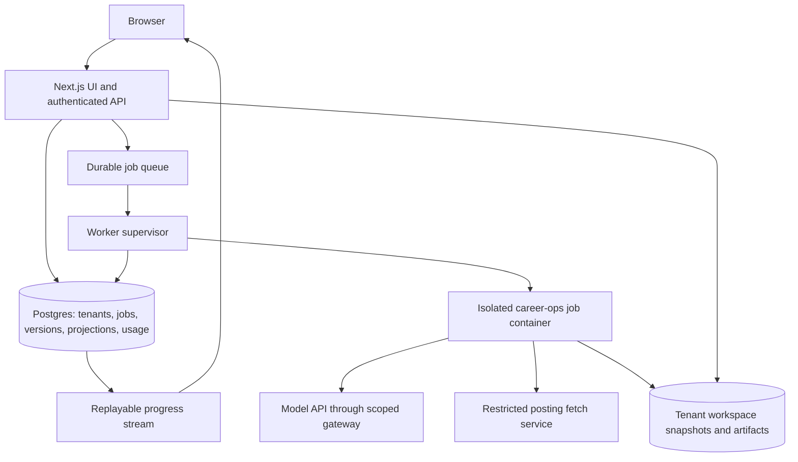

# Hosted web product using career-ops

Repository reviewed: career-ops-hq/career-ops, commit `3c15976d1c434403b73c5b6ca641101b85a30c65`, 19 November 2026. Root package version 1.40.0; web package version 0.18.0. This is a source review and proposed architecture, not a deployed or runtime-verified integration.

## Decision

Build a hosted application around career-ops as a versioned execution engine. Reuse its existing Next.js UI where useful, but replace its local execution boundary with an authenticated, asynchronous service. Keep each tenant's canonical files isolated and preserve upstream writers. Use direct model APIs for the first bounded evaluation/tailoring workflows; retain a sandboxed agent adapter only for features that actually require tools.

The repository is more than a collection of prompts, but it is not currently a multi-tenant backend service. Its existing `web/` app is a valuable head start. Merely adding login to that app would leave filesystem, process, browser-session, and concurrency assumptions unresolved.

## Findings tied to source

| Area | Evidence in reviewed source | Consequence |
|---|---|---|
| Existing web app | `web/package.json`: Next.js 16, React 19; `web/src/app/api/` has evaluation, discovery, profile, CV, follow-up, scheduling and apply routes | Audit and reuse screens and domain modules before building duplicate functionality |
| Engine access | `web/src/lib/core-cli.ts` executes root scripts; `web/src/lib/core/scan.ts` orchestrates the actual scanner | The project already demonstrates the adapter pattern we need |
| Evaluation | `web/src/app/api/run/route.ts` resolves a local CLI, builds prompts, spawns workers, streams output and coordinates persistence; declares maxDuration 800 | Extract orchestration from the request lifecycle into durable jobs |
| Restricted AI writes | `worker-capabilities.mjs`, `report-envelope.mjs`, `report-persist.mjs`: evaluation emits a report; backend persists it | Preserve this boundary; do not let job descriptions instruct a general agent to write tracker files |
| Direct model entrypoints | `openai-eval.mjs`, `openai-tailor.mjs`, `ollama-eval.mjs`, `gemini-eval.mjs` | Hosted execution need not depend on users installing or logging into coding CLIs |
| Evaluation persistence | `openai-eval.mjs` writes a report plus a headed TSV addition and instructs caller to run `merge-tracker.mjs` | An adapter must perform and verify the merge; a model response alone is not job completion |
| Canonical storage | `DATA_CONTRACT.md`: Markdown/YAML/TSV are canonical, `applications.db` is a derived SQLite index | Keep file ownership initially; use a database projection for the web product |
| Separate code/data | `path-resolver.mjs`, `web/src/lib/core/data-root.mjs`: data-root environment overrides; web code-root override | Mount immutable code separately from a tenant workspace |
| Process-global state | `career-ops.ts` resolves one data root; `run-registry.ts` uses a module-level Set | Never switch process.env between concurrent requests to select tenants |
| Local access boundary | `web/server.mjs`, `web/src/proxy.ts`, `origin-guard.mjs`: loopback bind, host/origin checks | These controls do not provide hosted user authentication or resource authorization |
| Browser state | `web/src/lib/apply/session.ts`: global session Map and headed browser process | Existing apply handoff cannot be copied directly into a cloud deployment |
| Local job history | `jobs-persist.mjs`: browser localStorage; restored running jobs become interrupted | UI history is not a durable server-side work queue |
| Container setup | Dockerfile installs tooling; compose mounts source and holds a shell open | Useful development ingredients, not a production web/worker deployment |

Source links use the pinned commit, for example:
- [Run route](https://github.com/career-ops-hq/career-ops/blob/3c15976d1c434403b73c5b6ca641101b85a30c65/web/src/app/api/run/route.ts)
- [Data contract](https://github.com/career-ops-hq/career-ops/blob/3c15976d1c434403b73c5b6ca641101b85a30c65/DATA_CONTRACT.md)
- [Web development contract](https://github.com/career-ops-hq/career-ops/blob/3c15976d1c434403b73c5b6ca641101b85a30c65/web/AGENTS.md)
- [Standalone evaluator](https://github.com/career-ops-hq/career-ops/blob/3c15976d1c434403b73c5b6ca641101b85a30c65/openai-eval.mjs)

## Target architecture



Logical components can initially run in a small number of services. Keep the API and worker as separate processes/deployments. Use a persistent Postgres database, private object storage and a durable queue. A Postgres-backed queue is sufficient initially; introducing Redis is optional. These are architecture choices, not performance claims established by this review.

The API handles identity, permissions, input validation, upload authorization, job submission and result access. It does not execute model work in a request handler. The worker supervisor owns leases, runtime limits, tenant workspace acquisition, publication and recovery. Job containers see only immutable engine code, one tenant's job input/workspace, and scoped service credentials.

## Workspace isolation and ownership

Use a personal tenant per account initially, with a tenant/membership model that can later support teams. Resolve tenant membership server-side on every request. Never accept a data-root path from the browser.

Suggested job layout inside a container:

```text
/opt/career-ops/                  immutable pinned engine
/workspace/                      one tenant's working copy
  cv.md
  config/profile.yml
  modes/_profile.md
  modes/_custom.md
  data/applications.md
  data/pipeline.md
  jds/
  reports/
  output/
  batch/tracker-additions/
```

Launch subprocesses with explicit child environments, including `CAREER_OPS_ROOT=/workspace`. When using web helpers, also set `CAREER_OPS_CODE_ROOT=/opt/career-ops`. Confirm each supported entrypoint honors the split layout. Use an allowlisted environment; do not inherit the API service environment wholesale. Do not mount parent tenant directories, host credentials, a Docker socket, or platform database administrator keys inside job containers.

Directories and environment variables select data; they are not security boundaries. Enforce isolation with per-job containers or stronger sandboxes, restricted mounts, non-root execution, resource limits and network rules. Plain child processes on a shared host are insufficient for broadly tool-enabled untrusted agent workloads.

For MVP, acquire one exclusive mutation lease per tenant before materializing its workspace. Hold it until publication, including profile and status changes. Each lease has an owner token and monotonic fencing token. Publish with a compare-and-swap against the expected workspace generation and live lease. A stale worker cannot publish after a retry has taken over.

Use immutable object-storage snapshots as the durable canonical workspace; local disk is a disposable job copy. Record the active snapshot pointer and generation in Postgres. Write a complete new snapshot before atomically changing the pointer. Garbage-collect abandoned uploads later. This avoids pretending a collection of object writes is an atomic filesystem update. An alternative is tenant volumes with reliable backups and tested locks, but do not combine independent mutable object storage and filesystem masters.

## Data model and consistency

Minimum tables:

| Table | Main fields / purpose |
|---|---|
| tenants, memberships | identity and authorized tenant membership |
| workspace_versions | tenant, generation, snapshot manifest, engine version, active pointer |
| profile_revisions | confirmed source facts, revision hash, provenance references |
| jobs | tenant, type, status, idempotency key, input hashes, engine/model version, attempt, lease, timestamps |
| job_events | tenant, job, ordered event sequence and sanitized progress |
| postings | public source identity, normalized URL, fetched text hash and freshness |
| applications | tenant-owned projection with stable UUID, source report number and workspace generation |
| evaluations | tenant, posting snapshot, profile revision, rubric version, result/report artifact |
| artifacts | tenant, object key, content hash, type, originating job, retention metadata |
| usage_ledger | provider request/attempt identifiers, actual or estimated usage, cost status |

Markdown remains authoritative for career-ops domain state in phase one. Postgres is authoritative for account control, jobs, leases, billing and snapshot pointers. Application rows in Postgres are projections, never a second independent master. All domain mutations run through engine writers against the leased workspace, then update the projection from committed output. Reads expose the generation so projection lag can be detected and repaired. Rebuild projections from snapshots during reconciliation.

Use globally unique web IDs. Engine report numbers such as `001` are only unique inside a tenant. Qualify every lookup and cache key by tenant. Public posting text may be cached globally where appropriate; personalized reports, prompt contexts, browser sessions and CVs must not be shared.

Do not simultaneously introduce a new database source of truth and preserve arbitrary upstream Markdown writes. If database-native domain storage is later needed, add a repository interface to the engine and migrate one operation at a time with parity tests and a clearly declared owner.

## Execution contract

Expose a small allowlisted adapter, not a generic shell endpoint:

```ts
interface CareerOpsEngine {
  scan(ctx: RunContext, input: ScanInput): Promise<ScanResult>;
  evaluate(ctx: RunContext, input: EvaluationInput): Promise<EvaluationResult>;
  tailor(ctx: RunContext, input: TailorInput): Promise<TailorResult>;
  renderPdf(ctx: RunContext, input: RenderInput): Promise<ArtifactResult>;
  setStatus(ctx: RunContext, input: StatusInput): Promise<MutationResult>;
}
```

`RunContext` is constructed by trusted server code and includes resolved workspace, engine version, job/attempt ID, profile revision, deadline, cancellation signal and progress sink. The client cannot supply executable names, CLI flags, template paths, provider base URLs or filesystem roots.

Start by running CLI entrypoints with fixed argument arrays in job containers. Some root files parse argv, perform top-level work or call process.exit, so importing them as library modules is not automatically safe. Extract import-safe functions only where needed, preserving CLI compatibility.

First model adapter: inspect and wrap `openai-eval.mjs` and `openai-tailor.mjs`, reusing canonical prompt construction and validators. For evaluation, validate the summary, persist the report/addition, run `merge-tracker.mjs`, and verify that the report links to the expected tracker row. For tailoring, prefer the existing backend-owned structured CV envelope and renderer where practical; validate facts, structure and locked sections before rendering. Do not assume standalone and agent-backed flows have identical research depth, output contracts or quality. Establish that with fixtures and a measured comparison.

Direct model calls are the default for bounded work. For research that needs tools, use an explicitly supported server-side agent runtime with a limited toolset inside the same isolation model. Do not base a hosted product on a single shared personal coding-CLI login. Provider/runtime commercial access, quotas and operating terms need verification during implementation.

Preserve upstream safeguards: only confirmed candidate facts support generated claims; imported documents propose facts for user confirmation; derived narrative is not verified evidence; external postings are data; the backend owns persistence; submissions remain human actions.

## API and job flow

Proposed hosted endpoints (not currently implemented):

| Endpoint | Contract |
|---|---|
| `POST /v1/uploads` | authorized upload ticket, size/type limits |
| `POST /v1/profile-imports` | parse upload into source-annotated proposals |
| `POST /v1/profile-revisions` | commit explicitly reviewed facts |
| `POST /v1/scans` | enqueue discovery |
| `POST /v1/evaluations` | enqueue evaluation of URL or pasted posting |
| `POST /v1/evaluations/:id/tailoring` | enqueue CV/letter generation |
| `GET /v1/jobs/:id` | authoritative state, progress, output references |
| `GET /v1/jobs/:id/events?after=sequence` | replayable SSE progress |
| `POST /v1/jobs/:id/cancel` | request cancellation |
| `PATCH /v1/applications/:id/status` | enqueue serialized engine mutation |
| `GET /v1/artifacts/:id/download` | tenant authorization, short-lived download |

Submission returns `202` with job ID. Require an idempotency key, scoped to tenant and operation, and reject reuse with different input. Pin the job's profile revision, posting content hash, rubric/engine commit and model configuration.

State machine: `queued -> running -> succeeded | failed | cancelled | needs_review`. Track internal stages such as fetching, evaluating, validating, persisting and rendering. A needs-review outcome has explicit reasons and proposed next actions, rather than silently becoming success.

Typical evaluation:
1. Authenticate and authorize; validate input and quota; capture immutable input references.
2. Create the job and durable queue record atomically, or use a transactional outbox.
3. Worker claims job and tenant lease; materializes confirmed profile and current workspace.
4. Fetch and archive posting; run liveness checks. Mark inaccessible/uncertain cases accurately and allow pasted text.
5. Run evaluator; emit sanitized progress; validate output before canonical writes.
6. Persist through engine writers and merge; verify expected artifacts and tracker relationship.
7. Upload new snapshot and artifacts; commit pointer, projections, usage and job result atomically in Postgres.
8. User sees completed report and can request tailoring as a separate job.

Queue delivery may repeat. Make publication and usage ingestion idempotent; do not promise exactly-once model calls. A crash after a paid model response can otherwise repeat cost. Persist validated intermediate responses by job/attempt and input hash for recovery. Retry transient provider failures with bounded backoff; do not blindly retry validation failures or user-confirmation gates. Closing a browser tab does not cancel a job. Cancellation stops the subprocess group, releases leases safely and cannot publish an unvalidated partial snapshot.

## Application autofill

Defer hosted autofill from the first release. The existing implementation keeps Playwright session objects in process memory and opens a headed browser on the machine running the backend. In cloud hosting, that machine is not the user's laptop.

MVP: provide reviewed CV, letter and answers, plus a link to the employer's page. User applies there and records status.

Later options:
- Browser extension or local companion: receives narrowly scoped application material after explicit user action and fills the actual employer page in the user's browser. Requires its own permission, origin, pairing and update design.
- Remote interactive browser: isolated browser per session with streaming and authenticated reconnection, session expiry and carefully bounded access. More operating cost and more login/CAPTCHA complexity.

Both keep final submission under user control. Reusing the submit guards is useful, but does not solve browser handoff or session isolation.

## Hosted security and operating requirements

Replace the local access assumption with real sessions and resource authorization. Preserve CSRF/origin defenses for cookie-backed requests. Check ownership of every job, report, artifact and event stream; opaque IDs alone do not authorize access.

Treat posting fetches as an SSRF surface: block private, loopback, link-local and cloud metadata addresses across DNS resolution, redirects and browser subrequests. Reuse existing URL/egress guards after testing their coverage in the new network architecture. Fetch workers must not reach control-plane services. Model gateway credentials should be short-lived/scoped where possible and never enter prompts or logs.

Sandbox document parsing and HTML/PDF rendering separately from control-plane secrets. Generated templates/HTML must not execute arbitrary scripts or fetch internal resources. Validate file containment and symlinks; allowlist MIME types and output paths; cap uploads, text size, model tokens, run time and concurrency.

Store private artifacts with tenant-scoped keys and authorized downloads. Encrypt durable storage, restrict service roles, redact logs and define deletion across snapshots, artifacts and backups. Explain model-provider data transfer during onboarding: hosted processing changes the repository's local-first privacy assumptions.

Meter discovery separately from AI work. Zero model tokens does not mean zero hosting/network cost. Record retries, PDF runtime, browser runtime and storage alongside model usage. Reserve a budget before enqueueing expensive work and reconcile actual usage afterward. Distinguish estimates from provider-reported cost.

## Implementation sequence and exit criteria

1. **Prove one complete hosted workflow locally.** Build the allowlisted worker wrapper with fixture profiles: evaluate a posting, merge tracker, tailor, validate and render PDF. No UI redesign needed. Exit: reproducible artifacts and correct source links under two independent data roots.
2. **Add isolation and durable orchestration.** Container runner, queue, leases, snapshots, retries, cancellation and events. Exit: simultaneous tenants cannot read or affect one another; duplicate delivery cannot duplicate committed results; worker crashes recover.
3. **Adapt the existing UI.** Add auth/onboarding; replace file-reading server pages and direct execution routes with tenant-aware services. Inventory every page and API route, not only `/api/run`. Exit: user can upload, confirm facts, evaluate, tailor, download and update status through the browser.
4. **Private hosted beta.** Add retention/deletion, quotas, usage ledger, operational diagnostics and backup/restore. Exit: privacy and recovery exercises pass and evaluation quality is measured against the current engine.
5. **Expand capability.** Scheduled scans, richer research and interview prep; choose an autofill approach only after the main product works. Promote read-only parallel work only when snapshots and mutation dependencies are explicit.

Required integration tests: cross-tenant ID access; concurrent roots; cache isolation; redirect/private-address fetches; malicious posting instructions; malformed model output; profile revision changes during a job; duplicate queue delivery; crash before/after snapshot publication; stale lease rejection; cancellation; tracker/report consistency; unsupported/missing CLI; PDF fact/structure gates; full tenant deletion. Run relevant upstream regression tests against the pinned engine and maintain a small golden set for scoring and tailoring parity.

Do not run the upstream self-updater inside production containers. Build and test a new immutable engine image, canary it against fixture snapshots, then promote it. Record engine commit and prompt/model versions on every result. Workspace migrations need explicit versioning and rollback planning; rolling back an image is not necessarily rolling back data.

## Product boundary and branding

The first useful product is: account -> reviewed career profile -> job discovery or pasted posting -> fit report -> tailored documents -> application tracker. This retains the repository's strongest capabilities while limiting the cloud-specific work.

The repository's LICENSE is MIT and includes permission language for modification, distribution and sale with its notice conditions. Its separate TRADEMARK.md reserves commercial naming and identity uses. Use a distinct product name and design, preserve applicable notices, and review third-party/assets licenses before release. This is a summary of repository documents, not a legal opinion.

## Remaining verification

No dependencies were installed, model requests made, tests run, browser flows exercised or hosting provisioned during this review. The design needs a real adapter spike to establish exact flags, error contracts, split-root compatibility, quality parity, latency and per-user cost. The largest uncertainty is how much of the existing rich agent-backed evaluation can be preserved in the first direct-API implementation without adding a bounded research tool loop.
