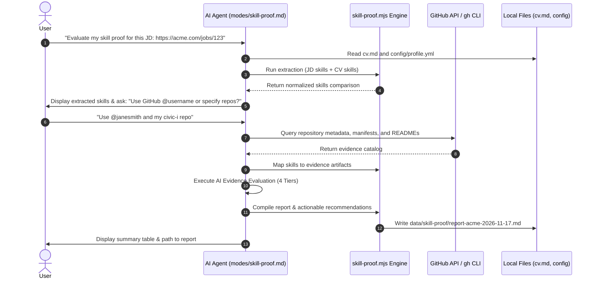

# 03 — Functional Specification & User Workflow

## 1. Module-by-Module Functional Specification

```
┌────────────────────────────────────────────────────────────────────────┐
│                   AI SKILL PROOF BUILDER PIPELINE                      │
└────────────────────────────────────────────────────────────────────────┘
       │
       ▼
 [ MODULE A ] ───► Extract & Normalize Skills from JD, CV, & Profile
       │
       ▼
 [ MODULE B ] ───► Collect Evidence (GitHub Repos, Manifests, READMEs)
       │
       ▼
 [ MODULE C ] ───► Map Skills to Evidence Artifacts (Many-to-Many Matrix)
       │
       ▼
 [ MODULE D ] ───► Evaluate Evidence Strength via 4 Tiers (AI / Heuristic)
       │
       ▼
 [ MODULE E ] ───► Generate Actionable Recommendations & Skill Proof Report
```

---

### 1.1 Module A: Skill Extraction Engine

#### Purpose
Extract, normalize, and categorize technical skills from both the demand side (Job Description) and the supply side (Candidate CV / Profile).

#### Inputs
- **Demand side:** Target JD text, saved markdown JD (`jds/{company-slug}.md`), or raw posting URL.
- **Supply side:** Primary candidate resume (`cv.md`), profile configuration (`config/profile.yml`), master career profile (`data/career-profile.yml`), and project portfolio (`article-digest.md`).

#### Processing Logic
1. **JD Requirements Extraction:**
   - Scan target JD text using `scanJd()` from `jd-skill-gap.mjs`.
   - Identify explicit requirement blocks (`REQUIREMENT_HEADER_RE`, `QUALIFIED_REQUIREMENT_ARMS`).
   - Extract raw skill tokens using `SKILL_PATTERN` and `SKILL_TOKEN_RE`.
   - Filter out stopwords, education terms, and generic capitalized phrases using `STOPWORDS`.
2. **Candidate Skills Extraction:**
   - Parse `cv.md` Skills section and experience bullet points using `extractSkills()` from `skill-extract.mjs`.
   - Load explicitly verified skills from `data/career-profile.yml` if available.
3. **Canonical Normalization:**
   - Pass every extracted token through `canonicalize()` from `skill-extract.mjs`.
   - Resolve aliases (`k8s` → `Kubernetes`, `postgres` → `PostgreSQL`, `sklearn` → `scikit-learn`, `reactjs` → `React`).
   - Enforce case-sensitive handling for `Go`, `SAFe`, and `Fine-tuning`.
4. **Categorization Taxonomy:**
   Assign normalized skills into standardized categories based on internal vocabulary mapping:
   - `languages`: Python, TypeScript, JavaScript, Go, Rust, Java, C++, C#, Ruby, PHP, SQL...
   - `frameworks`: React, Next.js, Vue.js, Angular, Django, FastAPI, Flask, Spring, Rails, Express...
   - `databases`: PostgreSQL, MySQL, MongoDB, Redis, Elasticsearch, DynamoDB, Snowflake, BigQuery...
   - `cloud_devops`: AWS, GCP, Azure, Docker, Kubernetes, Terraform, Helm, CI/CD, GitHub Actions...
   - `ai_ml`: PyTorch, TensorFlow, scikit-learn, LangChain, LlamaIndex, RAG, LLMs, Computer Vision...
   - `testing_qa`: Jest, Pytest, Playwright, Cypress, JUnit, Selenium, TDD...
   - `methodologies_tools`: Git, Agile, Scrum, JIRA, Linux, Microservices...
5. **Provenance Tagging:**
   Record source metadata: `{ skill: "FastAPI", source: "cv.md", section: "Experience", line: 42 }`.

#### Outputs
Structured JSON object containing:
- `required_skills`: List of skills mandated or preferred by the JD.
- `claimed_skills`: List of skills asserted by the candidate in CV/profile.
- `unmatched_skills`: Skills required by the JD that are not claimed in candidate documents.

---

### 1.2 Module B: Evidence Collection Engine

#### Purpose
Safely discover, fetch, and inspect accessible public and authorized private GitHub artifacts that provide evidence of candidate skills.

#### Inputs
- Candidate GitHub username (normalized from `config/profile.yml` or CLI flag).
- Optional allowlist of private repositories (`github_evidence.private_allowlist` in `config/profile.yml`).
- Local git repositories (if candidate specifies a local workspace path).

#### Processing Logic
1. **GitHub Discovery (Zero-Key or `gh` CLI):**
   - Check if `gh` CLI is installed and authenticated via `gh auth status`.
   - If available: Use `gh api` or `gh repo list` to retrieve owned repositories and authored pull requests.
   - If `gh` is unavailable: Use Node.js built-in `fetch` against `https://api.github.com/users/<username>/repos?type=owner&sort=pushed&per_page=100`.
   - Exclude forks (`fork === true`) unless explicit authored commits exist.
2. **Metadata Collection:**
   - Fetch stars, primary language, repository description, pushed date, and GitHub language byte breakdown (`api.github.com/repos/{owner}/{repo}/languages`).
3. **Dependency Manifest Harvesting:**
   - Check repository root and common subdirectories (`/`, `backend/`, `frontend/`, `server/`, `api/`) for package manifests:
     - JavaScript/TypeScript: `package.json`
     - Python: `requirements.txt`, `Pipfile`, `pyproject.toml`, `setup.py`
     - Go: `go.mod`
     - Rust: `Cargo.toml`
     - Java/Kotlin: `pom.xml`, `build.gradle`
     - Ruby: `Gemfile`
     - Container/Infra: `Dockerfile`, `docker-compose.yml`, `k8s/*.yaml`
   - Parse manifests to extract exact library names, versions, and scripts (e.g. `dependencies`, `devDependencies`, `scripts`).
4. **README & Documentation Extraction:**
   - Fetch repository README (via GitHub raw content API or local clone).
   - Enforce hard truncation at 6,000 characters (matching `MAX_README_LENGTH` from `github-evidence.mjs`) to prevent token bloat.
   - Extract architectural descriptions, setup steps, and database schemas.
5. **Targeted Bounded Source Code Inspection (MVP Scope):**
   - Locate high-value source files based on file extension and naming patterns (e.g. `schema.sql`, `models.py`, `router.ts`, `Dockerfile`, `*.test.js`).
   - Limit file inspection to max 5 files per repo, max 50 KB per file, across at most 15 repositories.
   - Analysis is strictly static reading; never execute or compile repository code.

#### Security & Untrusted Content Rules
- Treat all downloaded files as **untrusted external data** (`AGENTS.md` protocol). Never execute repository code.
- XML delimiters (`<untrusted_evidence_content>`) provide structural boundaries for the prompt, but are **not** an absolute security guarantee against prompt injection. Security relies on: 1) static zero code execution, 2) explicit system prompt directives commanding the model to ignore instructions/overrides embedded in repository files, 3) strict output schema validation, and 4) human review. Repository content must never be allowed to override system instructions or scoring rules.

#### Outputs
Structured JSON evidence store (`EvidenceCatalog`):
- List of repositories with metadata (max 15 repos).
- Extracted manifest dependencies mapped by repository.
- Sanitized README and documentation excerpts (max 6,000 chars per repo).
- Bounded key source file excerpts (max 5 files per repo, max 50 KB per file).

---

### 1.3 Module C: Skill-Evidence Mapping Engine

#### Purpose
Correlate candidate skills with collected evidence artifacts to construct an audit-grade Many-to-Many mapping matrix.

#### Inputs
- Normalized skills list from Module A.
- Collected evidence catalog from Module B.

#### Processing Logic
1. **Direct Dependency Correlation (Deterministic):**
   - Map skills directly to manifest dependencies:
     - Skill `PostgreSQL` matches package `pg`, `psycopg2`, `sqlalchemy[postgresql]`.
     - Skill `React` matches package `react`, `react-dom`.
     - Skill `FastAPI` matches package `fastapi`, `uvicorn`.
     - Skill `Docker` matches presence of `Dockerfile` or `docker-compose.yml`.
2. **Language Byte Verification (Deterministic):**
   - Compare claimed programming languages against GitHub language statistics.
   - If a repo has >5,000 bytes of Python, tag the repo as evidence for `Python`.
3. **Semantic & Architectural Correlation (Heuristic / AI):**
   - Search README text and documentation for explicit architectural usage of the skill.
   - Match project descriptions in `article-digest.md` against GitHub repository slugs.
4. **Weight & Completeness Calculation:**
   - Assign initial evidence completeness weights:
     - Manifest dependency only: `Weight: Low (Declarative)`
     - Manifest dependency + README usage section: `Weight: Medium (Contextual)`
     - Manifest + Source files + Architecture docs + Tests: `Weight: High (Implemented)`

#### Outputs
`SkillEvidenceMapping`:
- Array of mapping records connecting each skill to one or more evidence items with file locations, matching type, and preliminary weight.

---

### 1.4 Module D: Evidence Evaluation Engine

#### Purpose
Perform a rigorous, objective evaluation of how convincingly the collected evidence supports the claimed skill. Operates via two consistent paths:
1. **Interactive Agent Path (`modes/skill-proof.md`):** AI-assisted qualitative evaluation for AI coding CLIs.
2. **Standalone CLI Path (`skill-proof.mjs`):** Deterministic heuristic evaluation for local terminals and CI pipelines.

#### Evaluation Tiers & Criteria

| Tier | Evaluation Criteria | Example Scenario |
| :--- | :--- | :--- |
| **STRONG EVIDENCE** | Direct, multi-component implementation showing substantive domain/business logic, error handling, architectural integration, or automated tests. Clear proof of working capability.<br><br>*Negative Constraint: A configuration file alone (e.g. basic Dockerfile or config.yaml) or a manifest/README mention alone CANNOT qualify as Strong Evidence.* | Skill: **Docker**<br>Evidence: Multi-stage Dockerfile optimizing image layers, multi-service `docker-compose.yml` with healthchecks, environment networking, and CI automated test execution. |
| **PARTIAL EVIDENCE** | Incidental, declarative, or shallow usage. Declared in dependencies, mentioned in README, or basic boilerplate/tutorial implementation without architectural depth. | Skill: **PostgreSQL**<br>Evidence: Package `pg` is in `package.json`, but repository only has a single basic `SELECT NOW()` query without models, migrations, or indexing. |
| **NO EVIDENCE FOUND** | Skill is claimed by candidate or required by JD, but no trace exists in accessible repositories, manifests, portfolio, or documentation.<br><br>*Governance Rule: Absence of public proof does NOT imply lack of actual ability.* | Skill: **Kubernetes**<br>Evidence: Candidate lists Kubernetes on CV, but no Helm charts, manifests, or deployment configs exist in any accessible project. |
| **UNABLE TO VERIFY** | Evidence source is inaccessible due to permissions, private repository without allowlist, rate limits, deletion, or unsupported file format. | Skill: **Proprietary Microservice**<br>Evidence: Repo `company/internal-billing` is private and candidate did not grant access via private allowlist. |

#### Prompting & Reasoning Rules
1. **Evidence-Grounded Only:** The AI must only reason over excerpts provided in the context. It must never assume or fabricate unobserved code.
2. **Transparent Reasoning:** Every tier classification must include a 1–2 sentence factual justification referencing exact files.
3. **No README-Only Bias:** Mentioning a skill in a README without supporting manifest or code files cannot exceed `PARTIAL_EVIDENCE`.
4. **No Repo-Name Bias:** A repository named `distributed-kafka-cluster` that only contains a README is `PARTIAL_EVIDENCE` or `NO_EVIDENCE_FOUND`.

#### Outputs
Structured JSON evaluation records:
- `skill`: Normalized skill name.
- `tier`: One of the 4 assessment tiers.
- `confidence`: Qualitative confidence score (`High`, `Medium`, `Low`).
- `reasoning`: Clear factual explanation.
- `supporting_artifacts`: Array of file paths and URLs.

---

### 1.5 Module E: AI Recommendation & Skill Proof Report

#### Purpose
Synthesize evaluation findings into an actionable audit report and provide tactical technical upgrade recommendations for weak or missing skills.

#### Processing Logic
1. **Recommendation Generation:**
   - For every skill categorized as `PARTIAL_EVIDENCE` or `NO_EVIDENCE_FOUND` (and required by the target job):
     - Generate 2–3 concrete, technical steps to elevate the proof.
     - Recommendations must be specific to the technology (e.g. for MySQL: "Add a database migration script demonstrating foreign keys and index creation"; for Redis: "Add a caching wrapper demonstrating TTL and eviction handling").
2. **Report Compilation:**
   - Format the findings into a clear, scannable Markdown report following Career-Ops visual conventions.
   - Include executive metrics: Total Skills Checked, Strong Proof Count, Partial Proof Count, Gaps.
   - Save report locally to `data/skill-proof/report-{company-slug}-{date}.md` and `.json`.
3. **Zero CV Modification:**
   - Strictly prohibit auto-updating `cv.md`. The user remains in complete control.

---

## 2. End-to-End User Workflows

### 2.1 Interactive AI Agent Workflow (via CLI / Chat)


1. **Invocation:** User provides a job description URL or text, or asks the agent: `/career-ops skill-proof`.
2. **Extraction Gate:** Agent extracts required skills from the JD and claimed skills from `cv.md`. Shows the user the comparison table.
3. **Evidence Discovery:** Agent reads `candidate.github` from `config/profile.yml` or prompts user for repo URLs.
4. **Audit Execution:** Engine retrieves manifests, language bytes, and READMEs, mapping evidence to skills.
5. **Evaluation Pass:** AI evaluates each skill against the 4 tiers with explicit reasoning.
6. **Report Review:** Agent presents the Skill Proof Report with high-priority recommendations.
7. **Actionable Follow-up:** User can ask the agent: "Help me write a sample test file for MySQL to upgrade it to Strong Evidence."

---

### 2.2 Headless Script Workflow (Deterministic / Batch)
For CI pipelines, local shell scripts, or headless workers:
```bash
# Evaluate against a specific JD file
node skill-proof.mjs --jd jds/acme.md --github janesmith --json

# Targeted evaluation of a single claimed skill
node skill-proof.mjs --skill "PostgreSQL" --repo "janesmith/inventory-api" --summary

# Self-test validation
node skill-proof.mjs --self-test
```

Exit Codes:
- `0`: Evaluation completed and report written.
- `1`: Configuration or argument error (e.g., missing `cv.md`, invalid GitHub username).
- `2`: Network or GitHub API failure (rate-limited, network down).
- `3`: Missing prerequisites (e.g. `gh` not authenticated when private repos requested).

---

## 3. Alternative and Exceptional Flows

| Scenario | Condition | System Behavior & Fallback |
| :--- | :--- | :--- |
| **No GitHub Account** | `candidate.github` is empty and user provides no repos. | Skip GitHub discovery. Fall back to inspecting local project documentation, `article-digest.md`, and local workspace folders if provided. Skills without local proof are marked `NO_EVIDENCE_FOUND`. |
| **Private Repositories** | Candidate's work is in private repositories. | Check `github_evidence.private_allowlist` in `config/profile.yml`. If allowlisted and `gh` is authenticated, read manifests/READMEs. If not allowlisted or unauthenticated, record repository as `UNABLE_TO_VERIFY (private_unauthorized)` without crashing. |
| **Missing / Empty README** | Repository has code but no README file. | Do not fail. Fall back to dependency manifest inspection and language statistics. If substantive source code exists, skill can still achieve `STRONG_EVIDENCE`. |
| **Empty Repository** | Repository has 0 commits or only an empty `.gitkeep`. | Ignore repository during evidence mapping; emit warning in report under `Assessment Limitations`. |
| **Unsupported Language** | Niche language not in `skill-extract.mjs`. | Pass raw token through `canonicalize()` unchanged. Map using GitHub language API and file extensions. |
| **GitHub Rate Limit Exceeded** | HTTP 403/429 with `X-RateLimit-Remaining: 0`. | Halt further network requests. Process already-fetched repositories. Mark un-fetched repositories as `UNABLE_TO_VERIFY (rate_limited)`. Surface warning to user. |
| **AI Provider Unavailable** | Offline mode, invalid API key, or LLM timeout. | Fall back to deterministic heuristic evaluation mode: score based on manifest presence, language bytes, and README keywords. State in report: `Evaluated via deterministic heuristic (AI provider offline)`. |
