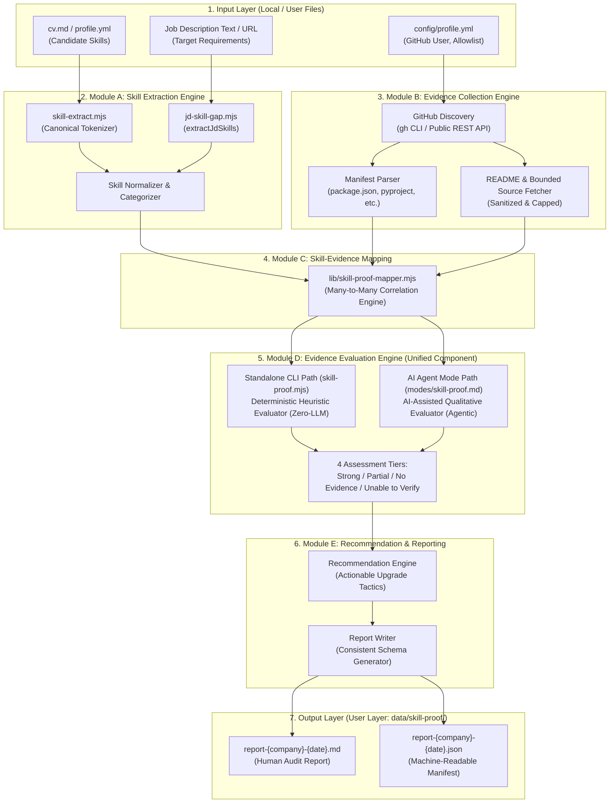
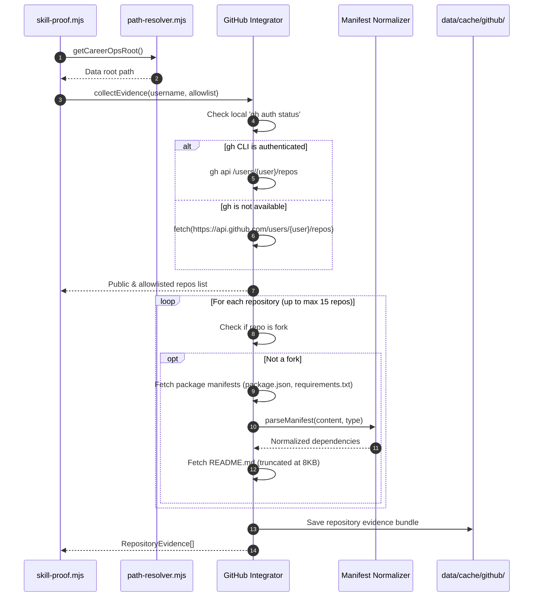
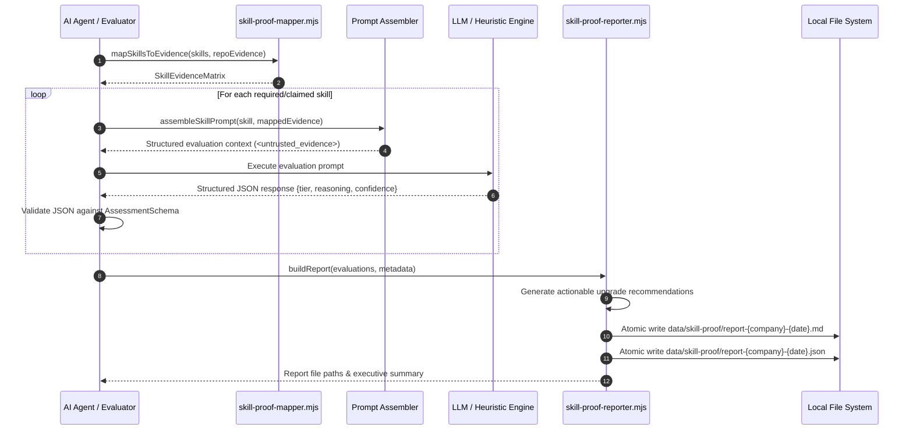
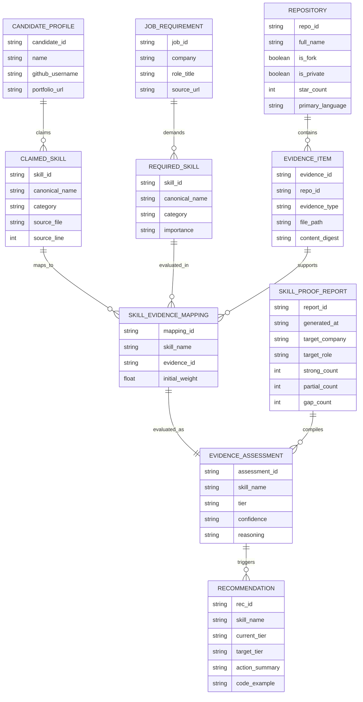

# 04 — System Architecture & Component Design

## 1. Architectural Philosophy & Context

The **AI Skill Proof Builder** is designed as a native, local-first extension to Career-Ops. It adheres to the established architectural doctrine of the project:
1. **Zero New Daemons / Servers:** No background Node or Python web services. Logic executes on demand via CLI or through AI prompt modes.
2. **Flat-Root Script Pattern:** Core CLI utilities reside in the repository root (`skill-proof.mjs`) alongside modular libraries in `lib/` (`lib/skill-proof-*.mjs`).
3. **Decoupled Deterministic & AI Layers:** Evidence collection, manifest parsing, and skill tokenization are 100% deterministic, dependency-free, and unit-testable. The AI layer is reserved purely for qualitative evidence evaluation and recommendation synthesis.

---

## 2. High-Level Architecture Diagram

---

## 3. Detailed Component Architecture

### 3.1 Component 1: Skill Extraction Component (`lib/skill-proof-extractor.mjs`)
- **Responsibility:** Ingests raw text from JDs and candidate resumes, identifies skill tokens, normalizes them against the canonical dictionary, and assigns categories.
- **Input:**
  - `jdText` (string)
  - `cvText` (string)
  - `profile` (object, from `config/profile.yml`)
- **Output:**
  - `ExtractedSkillsBundle` (`{ requiredSkills: Skill[], claimedSkills: Skill[], targetRole: string }`)
- **Dependencies:**
  - `skill-extract.mjs` (`extractSkills`, `canonicalize`, `SKILL_PATTERN`)
  - `jd-skill-gap.mjs` (`scanJd`, `STOPWORDS`)
- **Error Conditions:**
  - Empty input text → returns empty skill sets with diagnostic warnings.
  - CJK or non-Latin requirement headers → processed using `scanJd()` multilingual regex.

### 3.2 Component 2: GitHub Integration Component (`lib/skill-proof-github.mjs`)
- **Responsibility:** Interacts with GitHub safely to discover repositories, fetch metadata, read dependency manifests, and retrieve README content without executing code.
- **Input:**
  - `username` (string, normalized GitHub user)
  - `options` (`{ privateAllowlist: string[], since: string, skipReadmes: boolean }`)
- **Output:**
  - `RepositoryEvidence[]` (list of repo objects with metadata, parsed manifests, and sanitized READMEs)
- **Dependencies:**
  - `child_process` (for executing `gh api` when available)
  - Node.js native `fetch` (for public REST API fallback)
  - `lib/yaml-document.mjs` (for parsing YAML manifests)
- **Error Conditions:**
  - Rate limiting (HTTP 403/429) → returns partial evidence with `rateLimited: true`.
  - Non-existent user → exits gracefully with diagnostic error code 1.
  - Network disconnection → gracefully falls back to local cached data or returns error code 2.

### 3.3 Component 3: Evidence Normalization Component (`lib/skill-proof-manifests.mjs`)
- **Responsibility:** Parses raw manifest files across diverse package ecosystems and normalizes dependency names into canonical skill names.
- **Input:**
  - Raw manifest file contents (`package.json`, `requirements.txt`, `go.mod`, `Cargo.toml`, `Dockerfile`, etc.)
- **Output:**
  - `NormalizedDependencies` (`{ directDependencies: Set<string>, devDependencies: Set<string>, buildTools: Set<string> }`)
- **Dependencies:**
  - Standard JSON parser (`JSON.parse`)
  - Lightweight regex parsers for Python, Go, Rust, and Dockerfiles.
- **Error Conditions:**
  - Malformed `package.json` → logs warning, attempts regex fallback, does not crash.

### 3.4 Component 4: Skill-Evidence Mapping Component (`lib/skill-proof-mapper.mjs`)
- **Responsibility:** Builds the Many-to-Many correlation matrix between normalized skills and collected evidence items.
- **Input:**
  - `ExtractedSkillsBundle` (from Component 1)
  - `RepositoryEvidence[]` (from Component 2)
- **Output:**
  - `SkillEvidenceMatrix` (`Map<SkillName, EvidenceItem[]>`)
- **Dependencies:**
  - `lib/skill-proof-extractor.mjs`
- **Error Conditions:**
  - Zero matching evidence found → marks skill mapping as `unmapped`.

### 3.5 Component 5: Evidence Evaluation Component (`modes/skill-proof.md` & `lib/skill-proof-evaluator.mjs`)
- **Responsibility:** Evaluates mapped evidence against the four standardized assessment tiers (`STRONG_EVIDENCE`, `PARTIAL_EVIDENCE`, `NO_EVIDENCE_FOUND`, `UNABLE_TO_VERIFY`).
- **Two Execution Paths:**
  1. **AI Agent Mode (`modes/skill-proof.md`):** Used during interactive sessions with AI coding CLIs (Claude Code, Antigravity, OpenCode, Codex, Pi, Qwen). Performs qualitative reasoning over structured evidence excerpts inside `<untrusted_evidence_content>` XML tags.
  2. **Standalone CLI Heuristic (`lib/skill-proof-evaluator.mjs`):** Executed by `skill-proof.mjs` in local terminal runs and CI test suites. Runs **100% deterministically without an LLM** using a verified rule-based scoring engine (evaluating manifest presence, language bytes, and bounded source file evidence).
- **Input:**
  - `SkillEvidenceMatrix` (from Component 4)
  - Target role and candidate claim metadata
- **Output:**
  - Consistent JSON assessment bundle: `{ assessments: [{ skill, category, assessment_tier, confidence, reasoning, supporting_evidence }] }`
- **Dependencies:**
  - `lib/skill-proof-evaluator.mjs` (for deterministic heuristic scoring and schema validation).
- **Error Conditions:**
  - Malformed AI JSON response → caught by schema validator; triggers one correction attempt or falls back to deterministic heuristic grading.

### 3.6 Component 6: Recommendation & Reporting Component (`lib/skill-proof-reporter.mjs`)
- **Responsibility:** Synthesizes evaluation results, generates actionable upgrade tactics for partial/missing skills, and formats Markdown and JSON reports.
- **Input:**
  - Evaluated skill proof bundle and target job metadata.
- **Output:**
  - `data/skill-proof/report-{company-slug}-{date}.md`
  - `data/skill-proof/report-{company-slug}-{date}.json`
- **Dependencies:**
  - `fs`, `path`
  - `path-resolver.mjs` (ensuring outputs land in the User Layer data root).
- **Error Conditions:**
  - Unwritable output directory → creates missing directory under `{DATA_ROOT}/data/skill-proof/`.

---

## 4. Sequence Diagrams

### 4.1 Evidence Collection & Normalization Sequence

---

### 4.2 Skill Evaluation Sequence

---

## 5. Entity Relationship Diagram (ERD)

