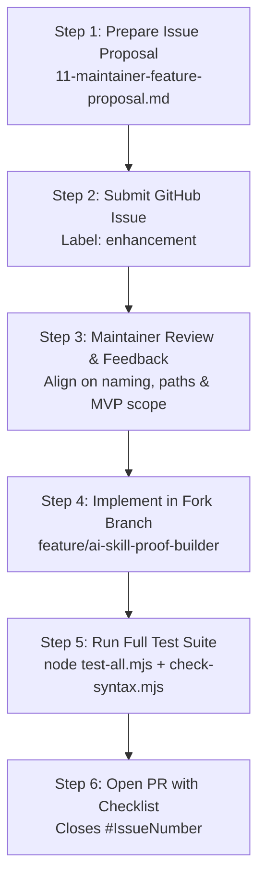

# 12 — Contribution Guidelines Review & Maintainer Process Analysis

## 1. Executive Summary

Before proposing any substantial feature to **Career-Ops**, prospective contributors must understand the repository's governance, review workflows, contribution ladders, and architectural invariants. This document analyzes the official contribution guidelines set forth in:
- `CONTRIBUTING.md`
- `README.md`
- `ARCHITECTURE.md`
- `DATA_CONTRACT.md`
- `.github/ISSUE_TEMPLATE/feature_request.yml`
- `.github/PULL_REQUEST_TEMPLATE.md`
- `.github/workflows/` (CI pipelines and bot automation)

Our analysis confirms that the proposed **AI Skill Proof Builder** must strictly follow the **"Issue-First"** protocol before submitting a Pull Request, must respect the **Zero-New-Dependency** and **Local-First** constraints, and must strictly avoid modifying user-layer files.

---

## 2. Review of Contribution Policies

### 2.1 The "Issue-First" Mandate for Features & Modes
In `CONTRIBUTING.md` (§ Before Submitting a PR), the repository maintainers state the non-negotiable policy:
> *"For a new feature, a new mode or command, or an architecture change, please open an issue first. It saves you from investing time in something we'd have to redirect, and lets us align on direction before you write code."*

Furthermore, `.github/PULL_REQUEST_TEMPLATE.md` explicitly reminds authors:
> *"Issue-first is asked for NEW FEATURES, new modes/commands, and architecture changes — it saves you from building something we'd have to redirect. No issue needed, send the PR straight in: bug fixes, new zero-auth scanner providers, docs, and translations."*

**Implication for AI Skill Proof Builder:**
Because the AI Skill Proof Builder introduces a new command (`node skill-proof.mjs`), a new mode (`modes/skill-proof.md`), and new evaluation logic, **we must submit a comprehensive GitHub Feature Request Issue first**. Jumping straight to code without maintainer alignment would violate the project's contribution contract.

---

### 2.2 Privacy-First Issue Policy
The GitHub Issue Template (`.github/ISSUE_TEMPLATE/feature_request.yml`) opens with an emphatic privacy warning:
> *"⚠️ Privacy first. career-ops runs locally. Never paste your CV, scan results, pipeline data, job listings, or other personal info — issues are public forever. Keep your data on your machine; share only sanitized snippets."*

**Implication for our Proposal:**
Any sample schemas, test fixtures, or evidence scenarios included in our issue or PR proposal must use sanitized, fictional names and anonymized data (e.g. `janesmith`, `Acme Robotics`, `inventory-api`), never real candidate data or live private job search information.

---

### 2.3 The Architectural Principles & Invariants
In `ARCHITECTURE.md` (§ Principles) and `CONTRIBUTING.md` (§ Scope: the core vs. the shared layer), Career-Ops defines three commitments that govern every architectural review:

1. **Local-First:**
   - Everything runs on the user's machine against their local files.
   - Core features must not require external hosted servers, databases, or accounts.
   - Features requiring cloud hosting, centralized scraping, or multi-tenant proxies belong in the separate opt-in layer, not in core.
2. **AI-Agnostic & Standalone Execution:**
   - Qualitative reasoning resides in Markdown prompt files (`modes/skill-proof.md`).
   - Standalone CLI tools (`skill-proof.mjs`) must be deterministic and run **without requiring an LLM**.
   - No single model is hardcoded. Solutions must work across Claude, Antigravity, OpenCode, Codex, Gemini, and local Ollama models.
3. **Human-in-the-Loop & Confirm-Before-Write:**
   - The tool evaluates and prepares; the human reviews, approves, and submits.
   - The tool must **never** automatically submit job applications and **never** overwrite `cv.md` or candidate files without an explicit interactive review gate.

---

### 2.4 Data Contract Compliance
As defined in `DATA_CONTRACT.md` and guarded in CI by `tests/updater-migration-tests.mjs`:
- **System Layer (`SYSTEM_PATHS`):** Versioned upstream files (`modes/*.md`, root `*.mjs`, `lib/*.mjs`, `templates/*`, `tests/*`). New system files must be registered in `SYSTEM_PATHS` in `lib/update-manifest.mjs`.
- **User Layer (`USER_PATHS`):** Personal data that the updater must **never** touch (`cv.md`, `config/profile.yml`, `data/`, `reports/`, `output/`).
- **Safety Invariant:** A PR that writes new output must direct those files into a User Layer directory (e.g., `data/skill-proof/`) and ensure no system path overlaps a user path.

---

### 2.5 Testing & CI Quality Gates (Verified Repository Standards)
We verified the actual repository test configuration:
1. **Test Runner Command:** The full test suite runs via:
   ```bash
   node test-all.mjs
   ```
   *(Note: `package.json` does NOT define an `npm test` script. Running `npm test` will fail. The repository standard is `node test-all.mjs`).*
2. **Auto-Discovery:** Tests placed in `tests/**/*.test.mjs` are automatically discovered and executed by `test-all.mjs` (currently discovering 1,260+ test suites).
3. **No External Frameworks:** Tests use `pass` and `fail` imported from `tests/helpers.mjs`.
4. **In-Process Safety:** Discovered tests run in-process and **must never call `process.exit()` or `finish()`**.
5. **Linting & Syntax:** Verified via:
   ```bash
   npm run lint          # executes 'node scripts/check-syntax.mjs'
   npm run verify        # executes 'node verify-pipeline.mjs'
   ```
6. **Code Review Automation:** CI triggers CodeQL security scans, dependency reviews, CodeRabbit AI reviews, and maintainer policy checks.

---

## 3. Step-by-Step Procedure for Submitting the Feature

Based on the repository guidelines, here is the exact procedural path for the AI Skill Proof Builder:



1. **Step 1 — Submit GitHub Feature Request Issue:**
   - Fill out `.github/ISSUE_TEMPLATE/feature_request.yml`.
   - Title: `[Feature Proposal]: AI Skill Proof Builder — Audit Technical Skills Against Repository Evidence`
   - Area: `Evaluation / Scoring`
   - Paste the sanitized maintainer proposal (`11-maintainer-feature-proposal.md`).
2. **Step 2 — Community & Maintainer Alignment:**
   - Discuss open design questions (e.g. `data/skill-proof/` vs `reports/`, script naming).
   - Incorporate feedback from project maintainers.
3. **Step 3 — Branch Implementation (After Approval):**
   - Work strictly on a dedicated branch (`feature/ai-skill-proof-builder`).
   - Implement the approved MVP modules in `skill-proof.mjs`, `modes/skill-proof.md`, `lib/skill-proof-*.mjs`.
   - Implement hermetic unit/integration tests in `tests/skill-proof-*.test.mjs`.
4. **Step 4 — Pre-PR Verification:**
   - Run `node test-all.mjs` (ensure 100% pass across all discovered tests).
   - Run `npm run lint` (`node scripts/check-syntax.mjs`).
   - Run `node updater-migration-tests.mjs` (verify Data Contract).
5. **Step 5 — Submit Pull Request:**
   - Fill out `.github/PULL_REQUEST_TEMPLATE.md`.
   - Link the approved issue (`Closes #<issue_number>`).
   - Confirm all checklist boxes (Data Contract, tests pass, no personal data, no external dependencies).
