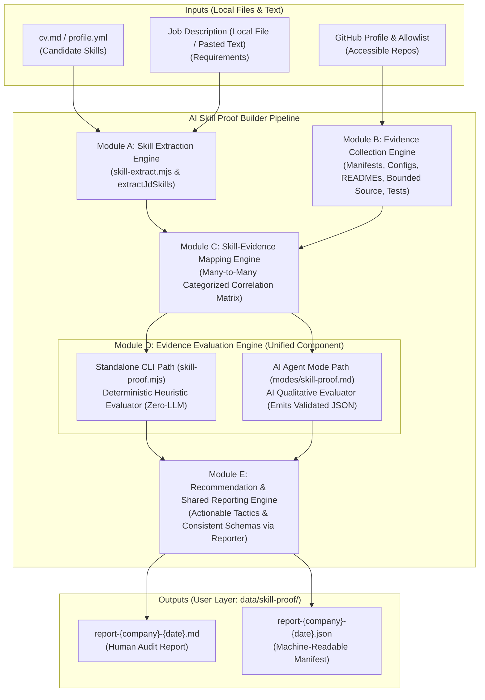

# 14 — Final Technical Consistency Review & Pre-Submission Audit

> **Feature:** AI Skill Proof Builder  
> **Review Date:** 2026-11-17  
> **Auditor:** Senior Software Architect, AI Engineer, Full-Stack Developer & Maintainer  
> **Target Repository:** `career-ops-hq/career-ops`  
> **Status:** READY FOR MAINTAINER REVIEW  

---

## 1. Executive Summary

Prior to submitting the proposed **AI Skill Proof Builder** feature request to Career-Ops maintainers, a comprehensive technical consistency audit was conducted across all planning, architectural, and proposal documents. 

This review verified repository claims against actual source code, established an unambiguous evidence quality hierarchy, clarified the execution boundaries between the AI agent mode and the standalone CLI, hardened the security specifications for GitHub interaction, and eliminated contradictory limits and scopes across the documentation suite.

---

## 2. Problems Identified & Corrections Made

During the audit, **eight distinct technical findings** across the primary review areas were audited, resolved, and codified:

| # | Focus Area | Finding Identified in Review | Resolution Applied |
| :---: | :--- | :--- | :--- |
| **1** | **Evidence Quality & Rubric** | Risk that package manifests, README mentions, or basic configuration files could be graded as strong proof. | **Codified 4-Level Quality Hierarchy & 5 Artifact Classes:** Manifest declarations, basic configuration files, and README mentions alone are **strictly capped at `PARTIAL_EVIDENCE`**. `STRONG_EVIDENCE` requires meaningful domain/business logic and multi-component architectural integration in source code. Automated tests directly exercising the technology are strongly positive and elevate confidence to `HIGH`, but are not strictly mandatory if substantive application logic exists. A configuration file alone cannot qualify. |
| **2** | **MVP Scope Consistency & Input Boundaries** | Contradictory statements regarding source-file inspection and undefined live URL fetching risks. | **Resolved MVP Scope & Input Safety:** Included **bounded static source-file inspection** with deterministic 5-file selection (max 5 key files/repo, max 50 KB/file, prioritized by schemas, routes, configs, tests). Standardized JD input strictly to local files (`jds/*.md`) and verbatim pasted text. Deferred live remote URL fetching (and associated SSRF/anti-bot risks), AST parsing, and deep code tracing to V2. Confirmed zero runtime code execution. |
| **3** | **Execution Architecture & Shared Reporting** | Ambiguity over whether `skill-proof.mjs` invoked an LLM and how AI mode outputs integrate with reports. | **Strict Architectural Separation & JSON Schema Validation:** Clarified that `skill-proof.mjs` is a **zero-LLM, deterministic CLI utility** using heuristic rule-based scoring. The qualitative AI evaluation pass is strictly encapsulated inside `modes/skill-proof.md`. AI mode emits validated structured JSON (`skill-proof-report.v1`), checked by `lib/skill-proof-evaluator.mjs`, and both CLI and agent paths converge on the shared reporter `lib/skill-proof-reporter.mjs` to write consistent Markdown and JSON outputs. |
| **4** | **GitHub Process Security** | Need for explicit, safe child process invocation and untrusted data handling. | **Hardened Process Security:** Mandated `defaultGhRunner()` using `spawnSync('gh', args, { shell: false })` with direct argument arrays. Banned shell string interpolation. Reaffirmed private repository allowlist (`github_evidence.private_allowlist`). |
| **5** | **Inspection Limits Standardization** | Inconsistent README limits (6,000 vs 8,000 vs 10,000 characters) across files. | **Standardized Limits Across All Docs:** Enforced: max 15 repositories, max 5 source files per repo, max 50 KB per file, and **max 6,000 characters per README** (matching `MAX_README_LENGTH` in `github-evidence.mjs`). |
| **6** | **Prompt Injection Security** | Risk of treating XML demarcation tags as an absolute security barrier. | **Clarified Delimiter Model:** Stated explicitly that XML delimiters are organizational boundaries, not a security guarantee. Defense-in-depth relies on static zero code execution, explicit system prompt directives commanding the model to ignore instructions/overrides embedded in repository files, rigid output schema validation, and human review. |
| **7** | **Repository Exports & APIs** | Inaccurate reference to `scanJd()` as an exported function from `jd-skill-gap.mjs`. | **Verified Repository Claims:** Inspected `jd-skill-gap.mjs` line 711; updated reference to the actual exported function `extractJdSkills(jdText)`. Verified exports for `skill-extract.mjs`, `path-resolver.mjs`, and `github-evidence.mjs`. |
| **8** | **Test Runner Claims & Metadata** | Mention of generic `npm test` script and non-standard author format. | **Corrected Test Command & Author:** Verified that `package.json` does not define an `npm test` script. Updated all guidelines to cite the actual runner: `node test-all.mjs` (discovering 1,260+ test suites in `tests/**/*.test.mjs`). Updated author metadata to generic `Author: Contributor`. |

---

## 3. Detailed Review Findings & Technical Justifications

### 3.1 Evidence Quality Hierarchy, Artifact Separation & STRONG_EVIDENCE Rigor
We explicitly partitioned evidence into five distinct artifact classes:
1. `dependency_manifests` (e.g. `package.json`, `requirements.txt`, `go.mod`, `Cargo.toml`)
2. `configuration_files` (e.g. `Dockerfile`, `docker-compose.yml`, `tsconfig.json`)
3. `source_code` (e.g. `*.py`, `*.ts`, `*.go`, `*.rs`, `*.java` application logic)
4. `tests` (e.g. `test_*.py`, `*.test.ts`, `*_test.go` test suites)
5. `documentation` (e.g. `README.md`, `docs/*.md`)

We established an explicit four-level evidence quality ladder to ensure objective, uninflated evaluations:

$$\begin{array}{rcc}
\textbf{Level 4: Meaningful Implementation \& Integration} & \longrightarrow & \text{Eligible for } \mathbf{STRONG\_EVIDENCE} \\
\textbf{Level 3: Basic Source Code or Config Invocations} & \longrightarrow & \text{Eligible for } \mathbf{PARTIAL\_EVIDENCE} \\
\textbf{Level 2: Documentation Mentions (README)} & \longrightarrow & \text{Capped at } \mathbf{PARTIAL\_EVIDENCE} \\
\textbf{Level 1: Manifest Declarations (package.json)} & \longrightarrow & \text{Capped at } \mathbf{PARTIAL\_EVIDENCE}
\end{array}$$

- **Rule 1.1:** A package appearing in `package.json` or `requirements.txt` proves declared intent, not execution. It cannot achieve `STRONG_EVIDENCE` alone.
- **Rule 1.2:** A technology mentioned only in `README.md` proves narrative context or roadmap intent. It cannot achieve `STRONG_EVIDENCE` alone.
- **Rule 1.3:** **A configuration file alone (e.g. a basic `Dockerfile`, a default `config.yaml`, or a standard CI file) does NOT qualify as `STRONG_EVIDENCE`.** Configuration without application code exercising the technology is merely declarative boilerplate, capped at `PARTIAL_EVIDENCE`.
- **Rule 1.4:** `STRONG_EVIDENCE` criteria:
  1. Substantive business/domain logic actively utilizing the technology in source code.
  2. Multi-component architectural integration (e.g. FastAPI connected to PostgreSQL with Alembic migrations and Pydantic validation schemas).
  3. Implementation context demonstrating clear functional responsibility, error boundaries, and state handling.
  4. **Role of Automated Tests:** Automated unit or integration tests directly exercising the technology are **strongly positive and elevate confidence to `HIGH`**, but are **not strictly mandatory** if there is extensive, substantive domain/business logic actively implemented and multi-component architectural integration in source code.

---

### 3.2 Final MVP Boundaries, Standardized Limits & Deterministic Selection
The MVP boundaries have been firmly standardized across every document in `planning/ai-skill-proof-builder/`:

- **Universal Inspection Limits:**
  - Maximum repositories inspected: **15 repositories** (sorted by most recently pushed).
  - Maximum source files inspected per repository: **5 files**.
  - Maximum single file size: **50 KB**.
  - Maximum README size fetched: **6,000 characters** (matching `MAX_README_LENGTH` in `github-evidence.mjs`, truncated safely at line boundaries).
- **Deterministic Source-File Selection (5-File Ceiling):**
  When multiple files in a repository match a skill, up to 5 files are selected deterministically using tiered prioritization:
  - **Priority 1 (Schemas & Data Models):** `schema.sql`, `models.py`, `models.ts`, `entities/`, `migrations/`.
  - **Priority 2 (Core Application Logic & Endpoints):** `main.py`, `app.py`, `server.ts`, `router.ts`, `routes/`, `api/`.
  - **Priority 3 (Infrastructure & Containers):** `Dockerfile`, `docker-compose.yml`.
  - **Priority 4 (Automated Test Suites):** `*.test.js`, `*.test.ts`, `test_*.py`, `*_test.go`.
  Within each tier, files are sorted strictly in ascending lexicographical order by relative repository path.
- **In-Scope for MVP:**
  1. Skill extraction and canonicalization via `skill-extract.mjs` (`extractSkills`, `canonicalize`) and `jd-skill-gap.mjs` (`extractJdSkills`).
  2. **Job Description Input:** Strictly local text/markdown files (e.g. `jds/acme.md`, `data/pipeline.md`) or verbatim pasted text via chat or `--stdin`. (Remote URL fetching is deferred to V2 to eliminate SSRF, anti-bot, and authentication complexities).
  3. Public repository discovery and language byte analysis via `gh` CLI / GitHub REST API.
  4. Static package manifest parsing (`package.json`, `requirements.txt`, `pyproject.toml`, `go.mod`, `Cargo.toml`, `Dockerfile`).
  5. Bounded README inspection (max 6,000 characters).
  6. **Bounded static source-file inspection:** Deterministic selection of up to 5 key files per repository (max 50 KB per file), with zero code execution.
  7. Deterministic heuristic assessment engine in `lib/skill-proof-evaluator.mjs` for zero-token CLI/CI use.
  8. AI agent prompt mode `modes/skill-proof.md` emitting validated JSON for qualitative evaluation.
  9. Actionable recommendations and Markdown/JSON report generation via shared reporter in `data/skill-proof/`.
- **Deferred to V2/V3:**
  - Automated remote JD URL fetching and live web crawling.
  - Abstract Syntax Tree (AST) parsing.
  - Multi-file call-graph tracing and taint analysis.
  - Non-GitHub forges (GitLab, Bitbucket).
  - Background commit polling daemons.
- **Strict Prohibition:**
  - Zero dynamic code execution. The system never runs `npm install`, `pip install`, `eval()`, or runtime interpreters on inspected repositories.

---

### 3.3 Unified Architecture & Dual-Path Execution Split
The architecture uses **ONE unified Evidence Evaluation component (`Module D`)** operating through two cleanly separated execution paths:

1. **Standalone CLI Path (`skill-proof.mjs`):** Executed in terminal runs or automated CI environments. It runs **100% deterministically without an LLM**, computing evidence completeness via rule-based heuristics and outputting structured evaluation JSON.
2. **AI Agent Mode Path (`modes/skill-proof.md`):** Executed during interactive sessions in AI coding CLIs (Claude Code, Antigravity, OpenCode, Codex, Pi, Qwen). Performs qualitative reasoning over structured excerpts inside XML tags and emits strictly validated JSON adhering to `skill-proof-report.v1`.
3. **Consistent Schemas via Shared Reporter:** Both paths pass their validated evaluation JSON into `Module E` (`lib/skill-proof-reporter.mjs`) to generate identical Markdown and JSON report schemas.
4. **Command Disclaimers:** All slash-command prompt examples (e.g. `/career-ops skill-proof jds/acme.md`) and CLI invocations (`node skill-proof.mjs ...`) referenced in documentation are strictly illustrative, as the feature has not yet been implemented.

---

### 3.4 GitHub Security & Prompt Injection Defenses
1. **Argument-Array Process Invocation:** All `gh` CLI invocations use `defaultGhRunner(args)` passing arguments as an array (`spawnSync('gh', ['api', ...], { shell: false })`). No shell string interpolation is permitted.
2. **Private Repo Allowlist:** Private repositories are accessed **if and only if** explicitly listed by the candidate in `config/profile.yml` under `github_evidence.private_allowlist`.
3. **Rate-Limit Resilience:** Inspects `x-ratelimit-remaining`. Halts network calls when remaining < 5; marks uninspected repositories as `UNABLE_TO_VERIFY (rate_limited)`.
4. **Prompt Injection Defense-in-Depth:**
   - External text is delineated with `<untrusted_evidence_content>` XML tags.
   - **Crucial Security Reality: XML delimiters are organizational boundaries, not a security guarantee.** An LLM can still parse malicious text inside tags if not defended.
   - Defense-in-depth relies on: 1) static zero code execution, 2) explicit system prompt directives commanding the model to ignore instructions/overrides embedded in repository files, 3) rigid output schema validation, and 4) human review.
   - **Repository content is never permitted to override system prompts, user instructions, or evaluation scoring rules.**

---

### 3.5 Assessment Rubric Rigor & Non-Defamatory Phrasing
- **`STRONG_EVIDENCE`:** Direct, substantive implementation demonstrating core domain/business logic, multi-component architectural integration, and implementation context. Automated tests directly exercising the technology strongly elevate confidence to `HIGH`, but are not strictly mandatory if substantive implementation logic and integration exist. (A configuration file alone, manifest declaration alone, or README mention alone CANNOT qualify).
- **`PARTIAL_EVIDENCE`:** Incidental or shallow usage. Declared in dependencies, mentioned in README, basic boilerplate, or configuration without application code.
- **`NO_EVIDENCE_FOUND`:** Claimed or required, but zero traces found in accessible evidence.
  - **Mandatory Non-Defamatory Phrasing:** The report must state: *"Absence of public evidence does NOT mean you lack the skill; it only means an external reviewer cannot independently verify it from your public repositories."*
- **`UNABLE_TO_VERIFY`:** Inaccessible evidence source (unauthorized private repository, rate-limited, deleted repository, binary format).
- **Confidence Levels:** Discrete qualitative tiers (`HIGH`, `MEDIUM`, `LOW`).

---

## 4. Verification Traceability Matrix

Every technical claim in the proposal was verified against the live Career-Ops repository:

| Technical Claim | Actual Repository File Inspected | Relevant Function, Line, or Configuration | Verification Result | Any Remaining Uncertainty |
| :--- | :--- | :--- | :--- | :--- |
| **Canonical Skill Extractor & Alias Mapping** | `skill-extract.mjs` | Lines 23–202 (`SKILL_TOKENS`), 281–378 (`CANONICAL`), Line 431 (`extractSkills`), Line 386 (`canonicalize`) | **VERIFIED.** Pure ESM, zero dependencies. Exports `extractSkills` and `canonicalize`. | None. |
| **JD Requirement Section & Skill Extraction** | `jd-skill-gap.mjs` | Lines 61–84 (`QUALIFIED_REQUIREMENT_ARMS`), Lines 289–309 (`STOPWORDS`), Line 473 (`extractJdSkills`), Line 711 (`export { extractJdSkills ... }`) | **VERIFIED.** `extractJdSkills(jdText)` is the exported entrypoint; `scanJd` is internal. | None. |
| **GitHub CLI Invocation & Process Safety** | `github-evidence.mjs` | Line 65 (`import { spawnSync }`), Line 402 (`GH_TIMEOUT_MS = 120_000`), Line 413 (`defaultGhRunner(args, spawn = spawnSync)`) | **VERIFIED.** Uses direct argument array `args` with `shell: false`, eliminating shell injection. | None. |
| **README Fetching Truncation Cap** | `github-evidence.mjs` | Line 95 (`export const MAX_README_LENGTH = 6000;`) | **VERIFIED.** Standardized limit is exactly 6,000 characters. | None. |
| **Private Repository Allowlist Convention** | `github-evidence.mjs` | Line 131 (`readPrivateAllowlist(profile)`), reading `profile?.github_evidence?.private_allowlist` | **VERIFIED.** Reusable function validates `owner/repo` pattern; invalid entries dropped. | None. |
| **User Layer Data Root Resolution** | `path-resolver.mjs` | Line 132 (`getCareerOpsRoot()`), Line 184 (`getProfilePath(rootDir)`) | **VERIFIED.** Respects `CAREER_OPS_ROOT`, marker file, plugin default, repo root. | None. |
| **Test Runner & Auto-Discovery** | `test-all.mjs` & `package.json` | Lines 41–45 in `test-all.mjs`; `package.json` scripts | **VERIFIED.** 1,265 test suites auto-discovered in `tests/**/*.test.mjs`. `package.json` has NO `npm test` script. Tests must run via `node test-all.mjs`. | None. |
| **System Paths Updater Registration** | `lib/update-manifest.mjs` | Lines 36–100 (`export const SYSTEM_PATHS = [ ... ]`) | **VERIFIED.** Strict array of string literals parsed by `extractArrayFromSource()` in `update-system.mjs`. New system files must be listed here. | None. |
| **PII Redaction Infrastructure** | `utils/privacy-filter.mjs` | Line 1 (`redactIfEnabled()`) | **VERIFIED.** Sanitizes email, phone, and addresses before calling AI APIs. | None. |
| **Data Contract User-Layer Immutability** | `DATA_CONTRACT.md` & `AGENTS.md` | User Layer vs System Layer tables; `cv.md` protection | **VERIFIED.** `cv.md` is strictly user-layer. Automatic overwriting is strictly prohibited. | None. |

---

## 5. Remaining Questions for Maintainers

The proposal surfaces four focused, well-formulated architectural questions for project maintainers:
1. **Output Directory Convention:** Does the maintainer team prefer `data/skill-proof/report-*.md` as a dedicated User Layer directory, or should reports be colocated under `reports/` (e.g. `reports/proof-{company}-{date}.md`)? *(Our recommendation: `data/skill-proof/` to avoid colliding with atomic report numbering).*
2. **CLI Executable Name:** Is `skill-proof.mjs` preferred over the shorter `proof.mjs`? *(Our recommendation: `skill-proof.mjs` for clarity).*
3. **`package.json` Scripts:** Is registering `"skill:proof": "node skill-proof.mjs"` and `"proof": "node skill-proof.mjs"` approved? *(Our recommendation: Yes).*
4. **Update Manifest Registration:** Should `lib/update-manifest.mjs` registration be included in the primary PR? *(Our recommendation: Yes, to ensure CI coverage passes).*

---

## 6. Pre-Submission Readiness Verdict

> **FINAL STATUS: READY FOR MAINTAINER REVIEW**  
>
> The proposal (`11-maintainer-feature-proposal.md`) is technically rigorous, fully consistent with existing Career-Ops architecture, introduces zero new dependencies, strictly respects the Data Contract and privacy boundaries, and is completely ready to be submitted as a GitHub Feature Request Issue.

---

## 7. Document Change Summary

The following documents in `planning/ai-skill-proof-builder/` were revised and aligned during this review:

1. 📄 [`index.md`](file:///c:/Users/agraw/career-ops/planning/ai-skill-proof-builder/index.md):
   - Removed duplicate status statements; unified status as `READY FOR MAINTAINER REVIEW`.
   - Updated high-level architecture diagram to show unified Evidence Evaluation component with dual execution paths (CLI and Agent) converging on consistent Markdown/JSON outputs.
   - Verified and cleaned all document links.
2. 📄 [`02-feature-requirements.md`](file:///c:/Users/agraw/career-ops/planning/ai-skill-proof-builder/02-feature-requirements.md):
   - Standardized README limit to 6,000 characters (FR-10).
   - Codified bounded static source-file inspection in MVP (FR-11).
   - Strengthened `STRONG_EVIDENCE` definition in FR-15 (configuration alone does not qualify).
   - Strengthened NFR-03: clarified that XML tags are organizational boundaries, not a security guarantee.
3. 📄 [`03-functional-specification.md`](file:///c:/Users/agraw/career-ops/planning/ai-skill-proof-builder/03-functional-specification.md):
   - Standardized README limit to 6,000 characters and bounded key source inspection to 5 files/repo, 50 KB/file, 15 repos.
   - Updated Module D with strengthened rubric (config alone cannot qualify as Strong Evidence).
   - Clarified that XML tags are structural delimiters and detailed defense-in-depth security.
4. 📄 [`04-system-architecture.md`](file:///c:/Users/agraw/career-ops/planning/ai-skill-proof-builder/04-system-architecture.md):
   - Corrected high-level Mermaid diagram to use unified Evidence Evaluation component with dual execution paths.
   - Rewrote Component 5 to cleanly separate interactive agent mode (`modes/skill-proof.md`) from zero-LLM standalone CLI (`skill-proof.mjs`).
5. 📄 [`06-github-integration-design.md`](file:///c:/Users/agraw/career-ops/planning/ai-skill-proof-builder/06-github-integration-design.md):
   - Standardized README limit to 6,000 characters.
   - Strengthened Section 5.2 on prompt injection: XML tags are organizational markers, not security guarantees; detailed multi-layered defense.
6. 📄 [`07-ai-evaluation-design.md`](file:///c:/Users/agraw/career-ops/planning/ai-skill-proof-builder/07-ai-evaluation-design.md):
   - Strengthened Section 2.1: configuration alone or README mention alone cannot qualify as Strong Evidence; meaningful use requires business logic, integration, implementation context, and automated tests.
   - Hardened Section 5 prompt design: explicit directive commanding models to never follow instructions/overrides embedded in repository files.
7. 📄 [`08-testing-and-security-plan.md`](file:///c:/Users/agraw/career-ops/planning/ai-skill-proof-builder/08-testing-and-security-plan.md):
   - Standardized README limit to 6,000 characters in Section 4.1.
   - Updated STRIDE threat model: clarified that XML tags are organizational boundaries, not an absolute security guarantee.
8. 📄 [`11-maintainer-feature-proposal.md`](file:///c:/Users/agraw/career-ops/planning/ai-skill-proof-builder/11-maintainer-feature-proposal.md):
   - Standardized limits: max 15 repos, max 5 source files per repo, max 50 KB per file, max 6,000 chars per README.
   - Strengthened `STRONG_EVIDENCE` definition in Sections 7 and 12.
   - Hardened prompt injection security in Section 11.
9. 📄 [`12-contribution-guidelines-review.md`](file:///c:/Users/agraw/career-ops/planning/ai-skill-proof-builder/12-contribution-guidelines-review.md):
   - Verified test runner command as `node test-all.mjs` (noting `npm test` is undefined in `package.json`).
   - Verified 1,260+ auto-discovered test suites in `tests/**/*.test.mjs`.
10. 📄 [`13-existing-feature-overlap-analysis.md`](file:///c:/Users/agraw/career-ops/planning/ai-skill-proof-builder/13-existing-feature-overlap-analysis.md):
    - Standardized limits: max 6,000 chars per README, max 15 repos, max 5 source files per repo, max 50 KB per file.
    - Strengthened `STRONG_EVIDENCE` definition and prompt injection security.
11. 📄 [`14-final-technical-review.md`](file:///c:/Users/agraw/career-ops/planning/ai-skill-proof-builder/14-final-technical-review.md) *(This Document)*:
    - Reconciled the 7 review areas with the 8 technical findings in Section 2.
    - Added the complete Verification Traceability Matrix (Section 4).
    - Updated status to `READY FOR MAINTAINER REVIEW`.
