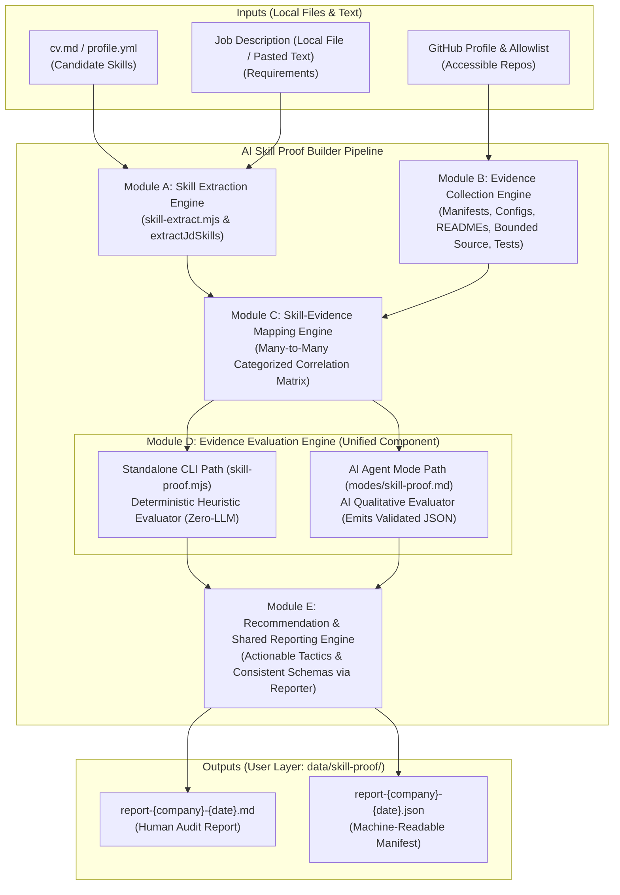

# AI Skill Proof Builder — Planning & Architecture Hub

> **Project:** Career-Ops  
> **Proposed Contribution:** AI Skill Proof Builder  
> **Status:** READY FOR MAINTAINER REVIEW (Planning & Architecture Complete — Zero Application Code Modified)  

---

## 1. Executive Summary

The **AI Skill Proof Builder** is a proposed open-source contribution to Career-Ops. It bridges the critical evidence gap in technical hiring by verifying whether technical skills claimed by a candidate (or demanded by a job description) are backed by authentic, accessible code artifacts in public and authorized GitHub repositories.

Rather than performing shallow keyword matching or assuming that repository ownership equates to skill mastery, the AI Skill Proof Builder establishes an end-to-end audit chain:

$$\text{Job Requirement} \longrightarrow \text{Candidate Skill} \longrightarrow \text{Supporting Evidence} \longrightarrow \text{Evidence Assessment} \longrightarrow \text{Actionable Recommendations}$$

Every assessment is grounded in verified code manifests, language statistics, documentation, and bounded key source files, categorized into four discrete tiers (`STRONG_EVIDENCE`, `PARTIAL_EVIDENCE`, `NO_EVIDENCE_FOUND`, `UNABLE_TO_VERIFY`), and supplemented with concrete recommendations to help candidates elevate weak proof points into compelling technical evidence.

---

## 2. Planning & Architecture Documentation Index

| Doc # | Document Title | Primary Focus & Contents |
| :---: | :--- | :--- |
| **01** | [Repository Analysis & Existing Capabilities](01-repository-analysis.md) | In-depth inspection of Career-Ops v1.40.0; Data Contract & boundaries; reuse of `skill-extract.mjs`, `jd-skill-gap.mjs`, `github-evidence.mjs`, and `career-profile.mjs`. |
| **02** | [Feature Requirements & Problem Definition](02-feature-requirements.md) | Problem definition; target personas; differences from ATS; 20 Functional Requirements (FR-01 to FR-20); Non-Functional Requirements (NFR); Phasing (MVP, V2, V3); Risk Analysis. |
| **03** | [Functional Specification & User Workflow](03-functional-specification.md) | Detailed specifications for Modules A through E; interactive agent workflow; headless CLI workflow; alternative and exceptional flows (private repos, rate limits, offline mode). |
| **04** | [System Architecture & Component Design](04-system-architecture.md) | High-level system architecture; 6 component definitions (inputs, outputs, dependencies, errors); Sequence diagrams; Entity-Relationship Diagram (ERD). |
| **05** | [Data Models & Schemas](05-data-models-and-schemas.md) | JSON schemas for Extracted Skills, GitHub Evidence Catalog, Skill-Evidence Mapping Matrix, and the comprehensive Skill Proof Report; concrete example instances. |
| **06** | [GitHub Integration Architecture & Safety Design](06-github-integration-design.md) | Discovery vs Collection vs Analysis vs Evaluation; `gh` CLI vs Public REST API; private repository allowlist; rate limiting; untrusted content rules & zero code execution. |
| **07** | [AI Evaluation Architecture & Rubric](07-ai-evaluation-design.md) | 4 Assessment Tiers rubric; Anti-Hallucination rules; qualitative confidence calibration; prompt template (`modes/skill-proof.md`); deterministic heuristic fallback engine. |
| **08** | [Testing Strategy & Security Plan](08-testing-and-security-plan.md) | Test architecture matching Career-Ops zero-framework runner; unit, integration, schema, mock, and security test suites; STRIDE threat modeling and prompt injection defenses. |
| **09** | [File-Level Implementation Plan & Roadmap](09-implementation-roadmap.md) | Proposed file inventory (`skill-proof.mjs`, `modes/skill-proof.md`, `lib/skill-proof-*.mjs`, `tests/*.test.mjs`); Sprint 1-4 roadmap; maintainer contribution checklist. |
| **10** | [Technical Decisions & Open Questions](10-technical-decisions-and-open-questions.md) | Architecture Decision Records (ADR-01 to ADR-08); trade-offs; focused questions for maintainers; technical risk mitigation summary. |
| **11** | [Maintainer Feature Proposal](11-maintainer-feature-proposal.md) | Ready-to-submit GitHub Feature Request issue covering problem, solution, modules, architecture, security, and benefits. |
| **12** | [Contribution Guidelines Review](12-contribution-guidelines-review.md) | Review of `CONTRIBUTING.md`, issue templates, PR requirements, Issue-First mandate, and CI quality gates. |
| **13** | [Existing Feature Overlap Analysis](13-existing-feature-overlap-analysis.md) | Comparative analysis against `skill-extract.mjs`, `jd-skill-gap.mjs`, `github-evidence.mjs`, `modes/expand.md`, and `upskill.mjs`; non-duplication guarantee. |
| **14** | [Final Technical Consistency Review](14-final-technical-review.md) | Pre-submission technical audit log, problems identified, corrections made, MVP boundaries, traceability matrix, and submission readiness verdict. |

---

## 3. High-Level Architectural Flow

---

## 4. Verification & Constraints Adherence Confirmation

- **No application source code was modified.**
- **No external packages or dependencies were installed.**
- **No unapproved frameworks or background daemons were created.**
- **All proposed artifacts strictly follow Career-Ops' local-first, AI-agnostic, human-in-the-loop architecture.**
- **The proposal is fully documented and ready for maintainer review.**
